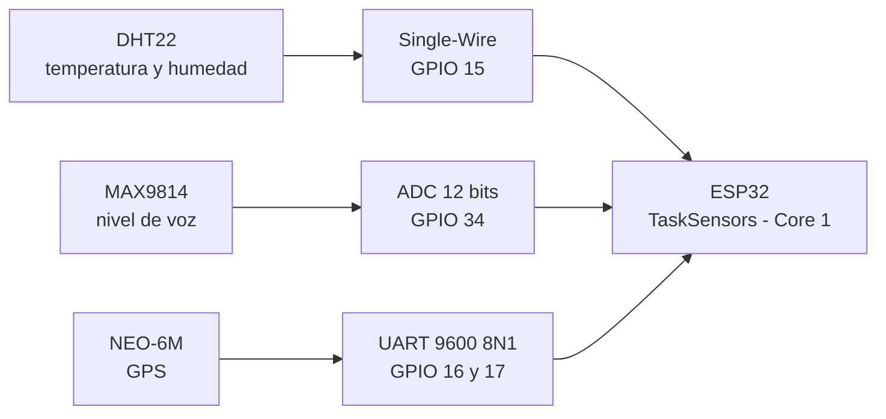

# 1. Sensores a utilizar

## Listado de sensores

| # | Sensor | Magnitud que mide | Pin del ESP32 |
|---|---|---|---|
| 1 | **DHT22 (AM2302)** | Temperatura y humedad relativa | GPIO 15 (digital) |
| 2 | **Micrófono MAX9814** | Nivel de voz (entrada de audio) | GPIO 34 (canal ADC1) |
| 3 | **GPS NEO-6M** | Latitud, longitud, altitud y hora UTC | RX = GPIO 16 · TX = GPIO 17 (UART2) |

> Los tres sensores usan **tres rutas de periférico distintas** (digital Single-Wire, ADC y
> UART). Esa es la razón por la que se pueden leer **en paralelo sin bloquearse**, y es justo
> lo que aprovecha la arquitectura de dos tareas FreeRTOS del punto 1.

## Características y protocolo de comunicación

### 1. DHT22 (AM2302) — temperatura y humedad

| Característica | Valor |
|---|---|
| Rango de temperatura | −40 a +80 °C |
| Precisión de temperatura | ±0,5 °C |
| Rango de humedad | 0 a 100 % HR |
| Precisión de humedad | ±2 % (típica) |
| Alimentación | 3,3 a 6 V |
| Frecuencia de muestreo | máximo 1 lectura cada 2 s (0,5 Hz) |
| **Protocolo** | **Single-Wire** propietario (1 hilo de datos *open-drain*; trama de 40 bits = 16 humedad + 16 temperatura + 8 checksum) |

### 2. Micrófono MAX9814 — nivel de voz

| Característica | Valor |
|---|---|
| Tipo | Micrófono electret con amplificador y **AGC** |
| Ganancia seleccionable | 40 dB / 50 dB / 60 dB (por pin) |
| Salida | Analógica, centrada en VDD/2 |
| Alimentación | 2,7 a 5,5 V |
| **Protocolo** | **Analógico → ADC** del ESP32 (12 bits, 0 a 3,3 V, resolución ≈ 0,8 mV) |

> **En la simulación** el micrófono se reemplaza por un **potenciómetro sobre el mismo canal
> ADC1 (GPIO 34)**: la ruta de lectura es idéntica (`analogRead()`), con lo que se valida el
> firmware sin depender del módulo físico. En la telemetría se envía el valor normalizado a
> **porcentaje (0–100 %)**, no la muestra cruda del ADC.

### 3. GPS NEO-6M — coordenadas

| Característica | Valor |
|---|---|
| Receptor | u-blox NEO-6M, 50 canales |
| Sensibilidad de seguimiento | −161 dBm |
| Frecuencia de actualización | hasta 5 Hz |
| Datos que entrega | latitud, longitud, altitud, velocidad y hora UTC |
| Alimentación | 3,3 a 5 V (módulo con antena cerámica) |
| **Protocolo** | **UART TTL a 9600 bps, 8N1**, con tramas **NMEA 0183** (`$GPGGA`, `$GPRMC`, `$GPGSV`…) |

> Mientras el GPS no tiene *fix* (o en la simulación), el firmware publica coordenadas de
> respaldo de Arequipa y lo declara explícitamente en el campo `"gps":"simulado"` de la trama.

## Rutas de comunicación (resumen)



## Librerías utilizadas

| Sensor | Librería | Para qué |
|---|---|---|
| DHT22 | `DHT.h` — **DHT sensor library** (Adafruit) | Lectura de temperatura y humedad (`dht.readTemperature()`, `dht.readHumidity()`) |
| DHT22 | `Adafruit_Sensor.h` — **Adafruit Unified Sensor** | Dependencia común de las librerías de sensores de Adafruit |
| GPS NEO-6M | `TinyGPS++.h` — **TinyGPSPlus** | Parseo de las tramas NMEA 0183 |
| GPS NEO-6M | `HardwareSerial` (incluida en el core del ESP32) | Puerto serie 2 (`Serial2`) a 9600 bps en los pines 16 y 17 |
| Micrófono MAX9814 | *ninguna* | Se lee directo con `analogRead()` del driver ADC del ESP32 |

Declaración exacta en el firmware:

```cpp
#include <DHT.h>
#include <Adafruit_Sensor.h>
#include <TinyGPS++.h>

DHT dht(PIN_DHT, DHT22);      // GPIO 15
TinyGPSPlus gps;              // UART2 a 9600 bps
HardwareSerial GPSSerial(2);
```

## Evidencia

**📷 Evidencia 1 — Sensores utilizados**

> Pendiente de captura: foto de los componentes reales (ESP32 + DHT22 + micrófono + GPS) **y/o**
> captura del catálogo de piezas del simulador Wokwi, donde se ven el DHT22, el potenciómetro
> que representa la voz y el módulo GPS de referencia.

> 📁 Guardar la captura en `evidencias/` con el nombre **`EVIDENCIA-1-sensores.png`**.
