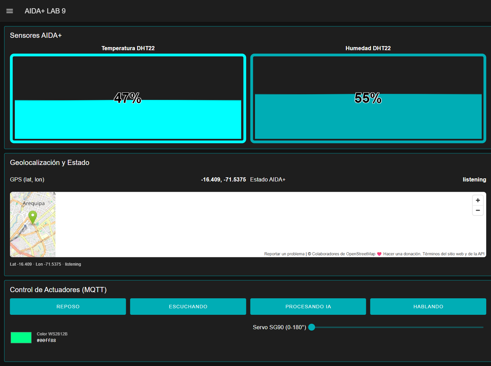

# 1. Node-RED y Dashboard — visualización de sensores

## Dashboard implementado

Se construyó la página **`AIDA+ LAB 9`** (ruta `/aida-lab9`) con **Node-RED Dashboard 2.0**
(`@flowfuse/node-red-dashboard` v1.33.0), servida por el propio Node-RED de la VPS.

| Grupo del dashboard | Widget(s) | Qué muestra |
|---|---|---|
| **Sensores AIDA+** | 2 × `ui-gauge` (tipo `gauge-tank`): Temperatura (°C, 0–60) y Humedad (%, 0–100) | Valores en tiempo real del DHT22 |
| **Geolocalización y Estado** | `ui-text` GPS · `ui-text` Estado · `ui-template` con mapa OpenStreetMap | Coordenadas, estado del asistente y ubicación en el mapa |
| **Control de Actuadores** | 4 × `ui-button`, color picker (`ui-template`), `ui-slider` | Envío de comandos al ESP32 (ver [05-dashboard-control.md](05-dashboard-control.md)) |

### Forma de mostrar los valores

- **Gauges tipo tanque** para temperatura y humedad: se eligió este tipo porque el rango es
  acotado y conocido (0–60 °C y 0–100 %), de modo que el nivel se interpreta de un vistazo.
- **Texto con JSONata** para las coordenadas y el estado, porque son valores discretos que
  cambian con cada trama.
- **Mapa** con un `ui-template` que recibe latitud y longitud y mueve el marcador; cuando el
  GPS no tiene *fix*, el firmware envía la ubicación de respaldo y el dashboard lo indica.
- El **estado del asistente** (`idle`, `listening`, `processing`, `speaking`) se muestra como
  texto y además se refleja en los colores de la tira LED y en la pantalla OLED del ESP32.

## Evidencia

**📷 Evidencia 4 — Dashboard con los valores de los sensores**

Captura del dashboard real (temperatura 47 % / humedad 55 % en los gauges, coordenadas
−16.409 / −71.5375, estado `listening` y el mapa con el marcador):

> El dashboard está publicado en `http://54.94.50.247:1880/ui/aida-lab9` y protegido con
> autenticación básica.
