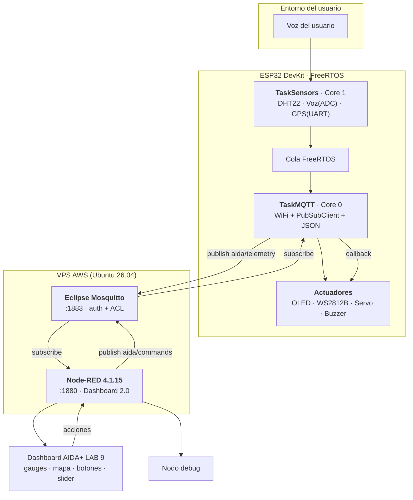
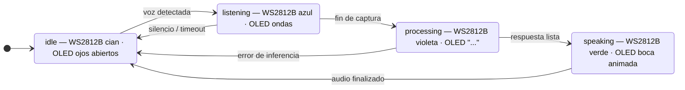
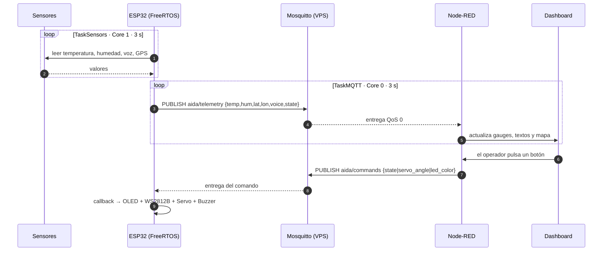
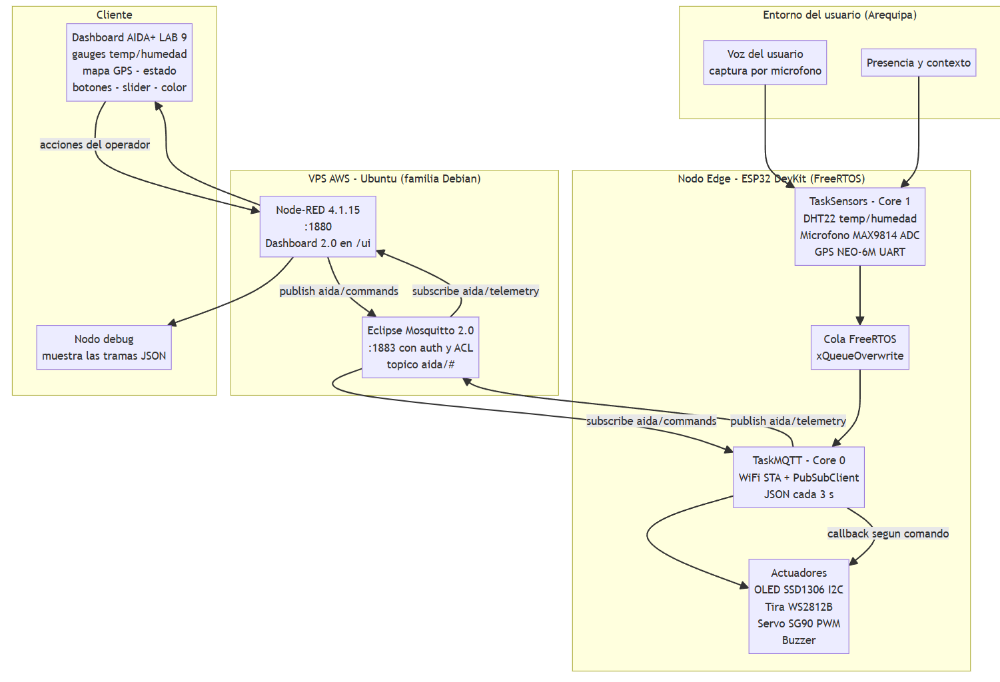
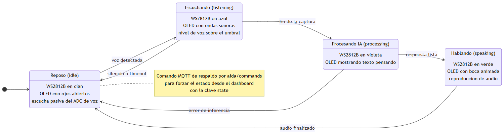
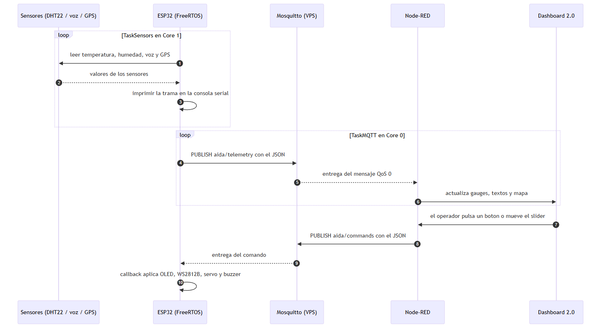

# 3. Diagrama UML de bloques y/o flujos

## 3.1 Diagrama de bloques

## 3.2 Diagrama de flujo de estados (comportamiento del asistente)

## 3.3 Diagrama de secuencia (extremo a extremo)

> **Fuentes de los diagramas:** los archivos `.mmd` (formato Mermaid, renderizables en GitHub
> y en Obsidian) están en el repositorio:
> [`content/uml/uml_aida_bloques.mmd`](../content/uml/uml_aida_bloques.mmd),
> [`content/uml/uml_aida_flujo_estados.mmd`](../content/uml/uml_aida_flujo_estados.mmd) y
> [`content/uml/uml_aida_secuencia.mmd`](../content/uml/uml_aida_secuencia.mmd).
> También están reunidos en [`content/uml/README.md`](../content/uml/README.md).

## Lectura de los diagramas

- **Bloques:** muestra las tres capas del sistema (campo → borde → nube) y, dentro del ESP32,
  las dos tareas FreeRTOS separadas por una cola, con los actuadores como salida del *callback*.
- **Estados:** modela el comportamiento del asistente. Es la pieza que hace que los botones del
  dashboard tengan sentido: cada comando lleva el sistema a un estado, y cada estado tiene una
  representación concreta en luz, pantalla y sonido.
- **Secuencia:** muestra el ciclo completo en el tiempo, incluido el lazo de control (dashboard
  → broker → ESP32 → actuadores).

## Evidencia

**📷 Evidencia 8 — Diagramas UML renderizados**

