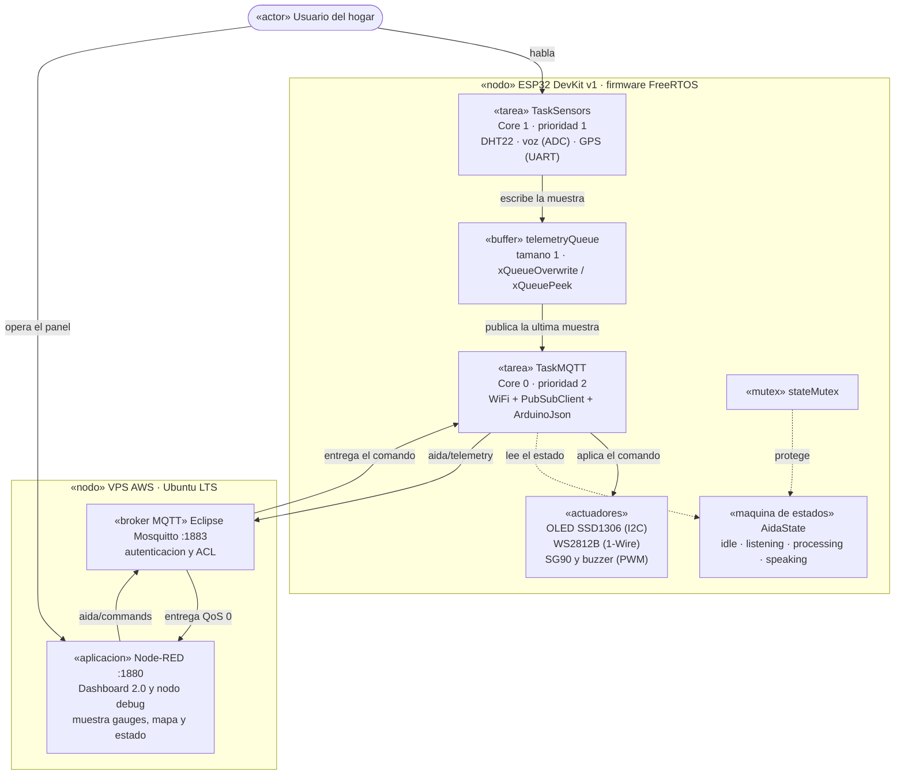

# Objetivo, problema y solución

## Objetivo del proyecto

Desarrollar **AIDA+**, un asistente inteligente **descentralizado y adaptable** cuyo nodo de
borde (**ESP32**) adquiere señales del entorno (temperatura, humedad, voz y ubicación), las
publica por **MQTT** hacia un **broker propio**, y puede ser **controlado en tiempo real** desde
un panel **Node-RED**, representando su estado interno mediante luz, pantalla y movimiento.

## Problema a solucionar

Los asistentes domésticos comerciales (Alexa, Google Home) **dependen de la nube de un
tercero**: sin Internet dejan de funcionar, envían datos personales a servidores externos y no
pueden adaptarse a necesidades específicas de un hogar (accesibilidad, idioma, privacidad).

Además, un sistema de este tipo suele fallar cuando la adquisición de sensores y la comunicación
de red se ejecutan en un **único bucle secuencial**: una lectura lenta o un broker caído
bloquean todo el sistema.

## Cómo soluciona

La solución implementada tiene cuatro piezas:

1. Un **broker Mosquitto propio** en la VPS del grupo, que el usuario controla (no un servicio
   de terceros).
2. Un **ESP32 con FreeRTOS** que separa en **dos tareas sobre dos núcleos** la adquisición de
   sensores (Core 1) y la comunicación MQTT (Core 0), **comunicadas por una cola**, de modo que
   una red lenta nunca detiene la lectura.
3. Un **dashboard Node-RED** que cierra el **lazo de control**: los widgets publican comandos
   MQTT que el ESP32 aplica sobre sus actuadores.
4. El estado del asistente modelado explícitamente como una **máquina de estados**
   (`idle → listening → processing → speaking`), visible en la OLED, la tira LED y el dashboard.

Y así se ve en el **diagrama UML de componentes** de la implementación:

El **comportamiento** del asistente (qué estado sigue a cuál) se muestra en el diagrama de
estados, y el **orden temporal** de los mensajes en el diagrama de secuencia. Los tres están en
[06-uml.md](06-uml.md), y sus fuentes `.mmd` en [`content/uml/`](../content/uml/).

## Relación problema → solución

| Problema | Cómo lo resuelve AIDA+ |
|---|---|
| Dependencia de la nube de un tercero | Broker Mosquitto **propio** en la VPS del grupo |
| Datos personales a servidores externos | La telemetría solo viaja al broker del propio proyecto |
| No se adapta a necesidades del hogar | Nodo de borde programable (ESP32) y dashboard propio |
| Un bucle secuencial bloquea todo | **Dos tareas FreeRTOS** en núcleos distintos, unidas por una cola |
| Falta de visibilidad del estado interno | **Máquina de estados** representada en OLED, tira LED y dashboard |
| No se puede accionar el sistema | **Lazo de control** por MQTT: dashboard → broker → ESP32 → actuadores |
