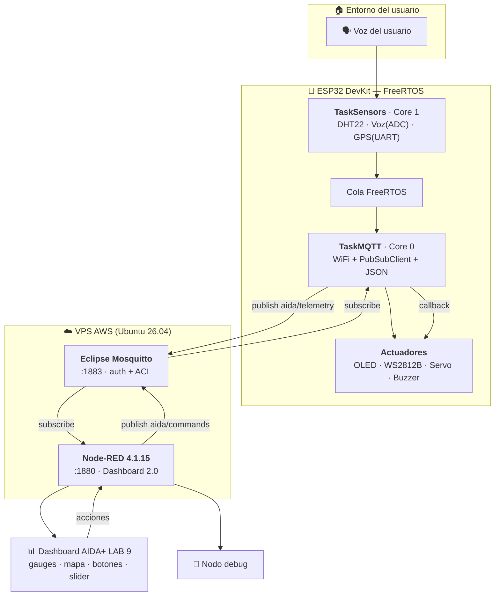
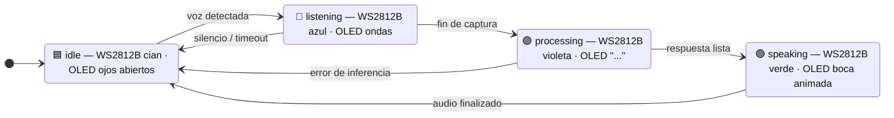
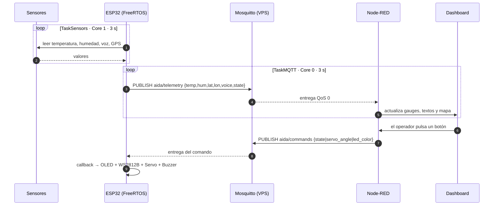

# **Laboratorio 9 – Proyecto de Semestre**

**Alumno(s):**

| # | Apellidos y nombres | Rol |
|---|---|---|
| 1 | **Torres Salazar, Uriel Aron** | Líder de proyecto · Firmware ESP32 / FreeRTOS |
| 2 | Mancha Vilca, Magaly Yulisa | Infraestructura VPS · Node-RED |
| 3 | Ccarita Apaza, Paola | Dashboard · Documentación |
| 4 | Canaza Viza, Xavi Andre | Sensores / hardware y simulación Wokwi |
| 5 | Ramos Choque, Alexis | Integración MQTT · Portal de evidencias |

**Proyecto:** **AIDA+** — *Asistente Inteligente Descentralizado y Adaptable*
**Repositorio / portal:** <https://aidaplus.vercel.app>
**Broker MQTT (VPS propia):** `54.94.50.247:1883` · usuario `aida`
**Dashboard Node-RED:** `http://54.94.50.247:1880/ui` → página **AIDA+ LAB 9**

---

## **Capacidades Terminales**

Al finalizar el laboratorio el estudiante será capaz de:

* Crear programas en Android Studio con el Lenguaje Kotlin.
* Crear una aplicación de Notificación.
* Crear una aplicación de captura de nuestra geolocalización.

> **Nota de alcance del grupo.** Este laboratorio es el **proyecto de semestre**, por
> lo que se priorizó el **Ejercicio 1 (sensores y actuadores)** completo y
> funcional sobre la VPS, incluyendo el firmware del ESP32 con FreeRTOS y
> PubSubClient, el broker Mosquitto con autenticación, el dashboard Node-RED y el
> control de actuadores por MQTT. La parte de **Android Studio/Kotlin**
> (notificación y geolocalización) se desarrolla como **entregable complementario**
> y se documenta de forma independiente; la geolocalización del asistente (GPS
> NEO-6M) sí está integrada en el prototipo IoT de este laboratorio.

**Seguridad:**

USANDO SOFTWARE:

* Se hará uso de software en la computadora, tener mucho cuidado con las conexiones eléctricas para su computadora.
* Prestar atención a las indicaciones del docente.
* El servidor remoto (VPS) se manipuló **únicamente por SSH** con clave privada `.pem`; no se habilitó login por contraseña ni acceso de `root` directo (se usó `sudo`).

**Equipos y Materiales:**

* Una computadora con:
  * Windows 7 o superior *(se usó Windows 11)*
  * Software de Android Studio
  * Software de Eclipse Mosquitto *(en el servidor Linux)*
  * Python 3.x
  * Conexión a Internet
* **ESP32 DevKit v4** (1 unidad — el único hardware físico disponible del grupo).
* **Simulador Wokwi** (extensión de VS Code + PlatformIO) para los sensores y actuadores.
* **VPS propia (AWS EC2)** con **Ubuntu 26.04 LTS** — familia Debian, comandos idénticos a Debian 12.

---

## **Procedimiento**

### Consideraciones de implementación (leer antes de las capturas)

1. **Sistema operativo del servidor.** La guía indica *"VPS con Debian 12"*. La VPS disponible responde realmente:

   ```
   PRETTY_NAME="Ubuntu 26.04 LTS"
   NAME="Ubuntu"
   VERSION_ID="26.04"
   ```

   Ubuntu es la distribución más usada de la **familia Debian**, por lo que todos los comandos de la guía (`apt`, `systemctl`, `mosquitto_passwd`, UFW) son **idénticos**. Se documenta el dato real por transparencia.

2. **Auditoría previa (no reinstalar lo existente).** Antes de instalar cualquier componente se auditó el servidor. Resultado: **Mosquitto 2.0.22**, **Node-RED 4.1.15**, **Node.js v20.20.2 / npm 10.8.2** y **Dashboard 2.0 (`@flowfuse/node-red-dashboard` v1.33.0)** ya estaban instalados y activos. **No fue necesario instalar nada**; sólo se realizó la configuración mínima (usuario MQTT, ACL y el flow).

3. **Continuidad con los laboratorios anteriores.** Los flows previos de la VPS (*Reto 8 SCADA*, *LAB 8*, *Domótica Reto 9*) se **preservaron**: el número de nodos pasó de **134 → 159** al añadir únicamente la pestaña `LAB 9 - AIDA+`. Se generaron respaldos `flows.json.bak-aida-<fecha>` y `flows_cred.json.bak-aida-<fecha>`.

4. **Simulación honesta.** El hardware físico real del grupo es un ESP32 desnudo; micrófono (MAX9814/INMP441), GPS (NEO-6M), tira WS2812B, OLED y servo **no** están disponibles físicamente. Por ello el prototipo se ejecuta en **Wokwi** (que compila y ejecuta el **binario real** generado por PlatformIO, por lo que el firmware que se evalúa es el definitivo, no un *mock*). Sustituciones documentadas:
   * **Micrófono → potenciómetro** en el **mismo pin ADC1** (`GPIO34`), por lo que la ruta de código `analogRead()` es idéntica.
   * **GPS NEO-6M → coordenadas fijas de Arequipa** `-16.4090, -71.5375` (el código sí instancia `TinyGPS++` y lee `Serial2`; al no haber *fix* válido publica el respaldo y lo marca como `"gps":"simulado"`).
   * **Amplificador MAX98357A → buzzer** para los tonos de confirmación (`tone()`).

---

## **EJERCICIO 1: Sensores**

### 1. **Lectura de sensores**

#### Listado, características, protocolo y librerías

| Sensor | Características principales | Protocolo de comunicación | Librerías (ESP32 / Arduino) |
|---|---|---|---|
| **DHT22 (AM2302)** | Temperatura −40 a +80 °C (±0,5 °C) y humedad relativa 0–100 % (±2–5 %). Alimentación 3,3–6 V. Frecuencia de muestreo ≤ 0,5 Hz (1 lectura cada 2 s). | **Single-Wire** propietario (1 hilo de datos *open-drain*, trama de 40 bits: 16 humedad + 16 temperatura + 8 checksum). | `DHT.h` · `Adafruit_Sensor.h` (`adafruit/DHT sensor library`, `Adafruit Unified Sensor`) |
| **MAX9814 / INMP441** (micrófono) | MAX9814: micrófono electret con **AGC**, ganancia seleccionable 40/50/60 dB, salida **analógica** (Vpp centrado en VDD/2). INMP441: MEMS, salida **digital I2S** de 24 bits, SNR 61 dB. | MAX9814 → **ADC** (lectura analógica). INMP441 → **I2S** (bus digital de audio, 3 hilos BCLK/WS/SD). | `analogRead()` (driver ADC1) · `driver/i2s.h` / `ESP32-audioI2S` |
| **NEO-6M GPS** | Receptor GPS u-blox de **50 canales**, hasta 5 Hz de actualización, sensibilidad −161 dBm, antena cerámica. Proporciona latitud, longitud, altitud, velocidad y hora UTC. | **UART TTL 9600 bps, 8N1** con tramas **NMEA 0183** (`$GPGGA`, `$GPRMC`, …). | `TinyGPS++.h` + `HardwareSerial` |

> 🧩 *Detalle de ingeniería:* los tres sensores usan **tres rutas de periférico distintas**
> (Single-Wire → GPIO digital, micrófono → ADC/I2S, GPS → UART). Esto permite leerlos
> **en paralelo** sin bloqueos, que es justamente lo que aprovecha la arquitectura
> FreeRTOS de dos núcleos.

**📷 Evidencia 1 — Listado de sensores / hardware**
> _Pegar captura: foto de los componentes reales (ESP32) y/o captura del catálogo de piezas en Wokwi con el DHT22, potenciómetro (voz) y el módulo GPS de referencia._

![Evidencia 1 — sensores del proyecto][image1]

---

#### Lectura de sensores por el microcontrolador (FreeRTOS + PubSubClient)

**Consola serial.** El firmware imprime cada 3 s una línea con **todas** las lecturas:

```
=====================================================
 AIDA+ · Laboratorio 9 · Nodo Edge AI (ESP32)
 Broker MQTT : 54.94.50.247:1883
 Telemetria  : aida/telemetry
 Comandos    : aida/commands
=====================================================
[AIDA+] Tareas FreeRTOS iniciadas (TaskSensors=Core1, TaskMQTT=Core0)
[WiFi] conectando a Wokwi-GUEST
[WiFi] conectado · IP: 10.0.0.2
[MQTT] conectando a 54.94.50.247:1883 como 'aida'...
[MQTT] conectado al broker Mosquitto (VPS)
[MQTT] suscrito a aida/commands
[SENSOR] T=24.5 C  H=48.2 %  VOZ=37 %  LAT=-16.4090  LON=-71.5375  (GPS simulado)  ESTADO=idle
[MQTT] >> aida/telemetry : {"device":"AIDA-ESP32-01","temp":"24.5","hum":"48.2","lat":"-16.4090","lon":"-71.5375","voice":37,"state":"idle","gps":"simulado","seq":1,"uptime":6}  (ok)
```

**Arquitectura de tareas (FreeRTOS).** Se usan dos tareas fijadas a núcleos distintos y una cola para desacoplar la adquisición de la publicación:

| Tarea | Núcleo | Prioridad | Responsabilidad |
|---|---|---|---|
| `TaskSensors` | **Core 1** | 1 | Lee DHT22 + potenciómetro (voz) + GPS, imprime en la consola serial y escribe la última muestra en la **cola** (`xQueueOverwrite`). |
| `TaskMQTT` | **Core 0** | 2 | Mantiene WiFi y la conexión MQTT, ejecuta `mqttClient.loop()` y publica el JSON cada 3 s (`xQueuePeek`). Atiende el **callback** de `aida/commands`. |

```cpp
// Fragmento representativo del firmware (src/main.cpp)
xTaskCreatePinnedToCore(TaskSensors, "TaskSensors", 4096, nullptr, 1, nullptr, 1);
xTaskCreatePinnedToCore(TaskMQTT,    "TaskMQTT",    6144, nullptr, 2, nullptr, 0);
```

```cpp
// TaskMQTT: serialización JSON con PubSubClient
StaticJsonDocument<320> doc;
doc["device"] = "AIDA-ESP32-01";
doc["temp"]   = serialized(String(latest.temp, 1));
doc["hum"]    = serialized(String(latest.hum, 1));
doc["lat"]    = serialized(String(latest.lat, 4));
doc["lon"]    = serialized(String(latest.lon, 4));
doc["voice"]  = latest.voice;
doc["state"]  = stateName(gState);
doc["gps"]    = latest.gpsFix ? "fix" : "simulado";
mqttClient.publish(TOPIC_TELEMETRY, out, len);
```

**Tópicos MQTT utilizados**

| Tópico | Dirección | QoS | Formato |
|---|---|---|---|
| `aida/telemetry` | ESP32 → Mosquitto → Node-RED | 0 | JSON cada 3 s |
| `aida/commands` | Node-RED → Mosquitto → ESP32 | 0 | JSON por evento |

**Trama JSON publicada (formato estable del proyecto)**

```json
{
  "device": "AIDA-ESP32-01",
  "temp": "24.5",
  "hum": "48.2",
  "lat": "-16.4090",
  "lon": "-71.5375",
  "voice": 37,
  "state": "idle",
  "gps": "simulado",
  "seq": 12,
  "uptime": 36
}
```

> Los valores numéricos se serializan **como cadena con un decimal fijo** (`serialized(String(...))`)
> para garantizar que siempre viajen con la misma precisión y evitar el
> redondeo por defecto de `ArduinoJson`, que en telemetría produce saltos de
> 0,1 °C en los gauges.

**📷 Evidencia 2 — Lectura en consola serial**
> _Pegar captura del monitor serial de Wokwi/PlatformIO (`monitor_speed = 115200`) mostrando las líneas `[SENSOR]` y `[MQTT] >>`._

![Evidencia 2 — consola serial][image1]

---

#### Visualización de las lecturas en Node-RED con el bloque **debug**

La pestaña `LAB 9 - AIDA+` recibe la telemetría y la muestra en el panel *debug*:

| Nodo | Función |
|---|---|
| `mqtt in` → `aida/telemetry` | Se suscribe al broker Mosquitto de la VPS (usuario `aida`) |
| `json` | Convierte el *string* JSON en objeto |
| `debug` **"DEBUG payload"** | Muestra `msg.payload` (las lecturas ya parseadas) |
| `debug` **"DEBUG trama completa"** | Muestra el `msg` completo (incluye `topic`) |

**📷 Evidencia 3 — Bloque debug de Node-RED**
> _Pegar captura de Node-RED con la pestaña `LAB 9 - AIDA+` abierta y el panel lateral derecho mostrando los objetos JSON de `aida/telemetry` con los campos `temp`, `hum`, `lat`, `lon`, `voice`, `state`._

![Evidencia 3 — bloque debug][image1]

---

#### Node-RED y Dashboard

Página de dashboard **`AIDA+ LAB 9`** (ruta `/aida-lab9`) construida con **Node-RED Dashboard 2.0**:

| Grupo | Widget(s) | Qué muestra |
|---|---|---|
| **Sensores AIDA+** | `ui-gauge` Temperatura (°C, aguja) · `ui-gauge` Humedad (%, aguja) | Valores en tiempo real de DHT22 |
| **Geolocalización y Estado** | `ui-text` GPS · `ui-text` Estado · `ui-template` mapa OpenStreetMap | Coordenadas, estado y ubicación del asistente |
| **Control de Actuadores** | 4 × `ui-button`, `ui-template` color picker, `ui-slider` | Envía comandos al ESP32 (ver punto 2) |

**📷 Evidencia 4 — Dashboard de sensores**
> _Pegar captura del dashboard (`http://54.94.50.247:1880/ui` → AIDA+ LAB 9) con los dos gauges mostrando temperatura y humedad, los textos de GPS/estado y el mapa con el marcador en Arequipa._

![Evidencia 4 — dashboard de sensores][image1]

---

### 2. **CONTROL DE ACTUADORES**

#### Listado, características, protocolo y librerías

| Actuador | Características principales | Protocolo de comunicación | Librerías (ESP32 / Arduino) |
|---|---|---|---|
| **OLED SSD1306** | Display monocromo 128×64 px, controlador SSD1306, alto contraste, 3,3–5 V. Se usa como "cara" del asistente. | **I²C** (dirección `0x3C`, hasta 400 kHz) | `Wire.h` · `Adafruit_GFX.h` · `Adafruit_SSD1306.h` |
| **Tira LED WS2812B** | LEDs RGB **direccionables** individualmente (8 píxeles). 5 V, ~60 mA por LED a blanco pleno. Se usa para comunicar el **estado** y el **color global**. | **1-Wire NZR** propietario (800 kHz, codificación por duración de pulso; *no* es SPI) | `Adafruit_NeoPixel.h` (alternativa: `FastLED`) |
| **MAX98357A + parlante** (o PAM8403) | Amplificador digital clase D, 3,2 W a 4 Ω, alimentación 2,5–5,5 V. Reproduce la voz del asistente. Alternativa analógica PAM8403. | **I²S** (BCLK / LRCLK / DIN) — o analógico en PAM8403 | `driver/i2s.h`, `ESP32-audioI2S` · en simulación: `tone()` sobre buzzer |
| **Servomotor SG90** | Micro servo de rotación 0–180°, torque 1,8 kg·cm, 4,8–6 V. Se usa para orientar un gesto/dispositivo del asistente. | **PWM** (pulso de 1–2 ms repetido a 50 Hz) | `ESP32Servo.h` |

**📷 Evidencia 5 — Actuadores**
> _Pegar captura del diagrama de Wokwi (`diagram.json`) con la OLED SSD1306, la tira WS2812B, el servo y el buzzer conectados al ESP32, y/o foto de los módulos reales._

![Evidencia 5 — actuadores][image1]

---

#### Node-RED y Dashboard (backend → nodo MQTT → ESP32)

El dashboard de control **no** habla con el ESP32: publica en el broker, y el ESP32 reacciona en su *callback*.

```
[ui-button / ui-slider / color picker]
        │  (msg.payload)
        ▼
   [function]  ──►  [mqtt out]  ──►  Mosquitto  ──►  aida/commands  ──►  ESP32
```

**Comandos implementados**

| Control en el dashboard | Publica en `aida/commands` | Efecto en el ESP32 |
|---|---|---|
| Botón **REPOSO** | `{"state":"idle"}` | OLED ojos abiertos · WS2812B **cian** · beep 900 Hz |
| Botón **ESCUCHANDO** | `{"state":"listening"}` | OLED ondas sonoras · WS2812B **azul** |
| Botón **PROCESANDO IA** | `{"state":"processing"}` | OLED "…" · WS2812B **violeta** |
| Botón **HABLANDO** | `{"state":"speaking"}` | OLED boca animada · WS2812B **verde** · beep 1200 Hz |
| **Selector de color** (color picker) | `{"led_color":"#00ff88"}` | Pinta los 8 LEDs de la tira con el color elegido |
| **Slider** Servo SG90 (0–180°) | `{"servo_angle":135}` | `servo.write(135)` · confirma con beep 700 Hz |

**Código del callback en el ESP32**

```cpp
void mqttCallback(char *topic, byte *payload, unsigned int length) {
  StaticJsonDocument<256> doc;
  deserializeJson(doc, payload, length);

  if (doc.containsKey("state"))       { /* OLED + WS2812B + beep */ }
  if (doc.containsKey("led_color"))   { parseHexColor(doc["led_color"], r, g, b); applyStrip(r, g, b); }
  if (doc.containsKey("servo_angle")) { servo.write(constrain((int)doc["servo_angle"], 0, 180)); }
}
```

**Trazas de consola al recibir comandos**

```
[MQTT] << aida/commands : {"state":"listening"}
[AIDA+] estado -> listening
[MQTT] << aida/commands : {"led_color":"#00ff88"}
[AIDA+] WS2812B -> R0 G255 B136
[MQTT] << aida/commands : {"servo_angle":135}
[AIDA+] Servo -> 135 grados
```

**📷 Evidencia 6 — Que el ESP32 obedece al dashboard**
> _Pegar captura (o dos capturas lado a lado) mostrando: (a) el dashboard con los botones/slider/color, y (b) el monitor serial con las líneas `[MQTT] << aida/commands` y `[AIDA+] …`, y el cambio de color del servo/OLED/tira en Wokwi._

![Evidencia 6 — control desde el dashboard][image1]

**📷 Evidencia 7 (opcional) — Verificación del broker**
> _Pegar captura de `sudo grep -a 'aida/' /var/log/mosquitto/mosquitto.log | tail`, donde se ve `New client connected … as nr-aida-lab9 (… u'aida')` y la entrega de `aida/telemetry` a Node-RED._

---

### 3. **Diagrama UML de bloques y/o Flujos**

| | |
|---|---|
| **Objetivo del proyecto** | Desarrollar **AIDA+**, un asistente inteligente **descentralizado y adaptable** cuyo nodo de borde (ESP32) adquiere señales del entorno (temperatura, humedad, voz y ubicación), las publica por **MQTT** hacia un broker propio, y puede ser **controlado en tiempo real** desde un panel Node-RED, representando su estado interno mediante luz, pantalla y movimiento. |
| **Problema a solucionar** | Los asistentes domésticos comerciales (Alexa, Google Home) **dependen de la nube de un tercero**: sin Internet dejan de funcionar, envían datos personales a servidores externos y no pueden adaptarse a necesidades específicas de un hogar (accesibilidad, idioma, privacidad). Además, un sistema de este tipo suele fallar cuando la adquisición de sensores y la comunicación de red se ejecutan en un **único bucle secuencial**: una lectura lenta o un broker caído bloquean todo el sistema. |
| **Cómo soluciona** | Con una arquitectura **descentralizada de borde**: (1) un **broker Mosquitto propio** en la VPS del grupo, que el usuario controla; (2) un **ESP32 con FreeRTOS** que separa en **dos tareas sobre dos núcleos** la adquisición de sensores (Core 1) y la comunicación MQTT (Core 0), comunicadas por una **cola**, de modo que una red lenta nunca detiene la lectura; (3) un **dashboard Node-RED** que cierra el lazo de control publicando comandos MQTT que el ESP32 aplica sobre sus actuadores. El estado del asistente se modela explícitamente como una **máquina de estados**. |

#### 3.1 Diagrama de bloques



#### 3.2 Diagrama de flujo de estados (comportamiento del asistente)



#### 3.3 Diagrama de secuencia (extremo a extremo)



> 📁 Los fuentes de los diagramas están en el repositorio:
> `content/uml/uml_aida_bloques.mmd`, `content/uml/uml_aida_flujo_estados.mmd` y
> `content/uml/uml_aida_secuencia.mmd` (formato **Mermaid**, renderizable en GitHub/Obsidian).

**📷 Evidencia 8 — Diagrama UML**
> _Pegar captura de los diagramas renderizados (draw.io / Mermaid Live Editor / Obsidian)._

![Evidencia 8 — diagramas UML][image1]

---

**Copiar el link del video y pégalo aquí:**

| |
|---|
| _[ PENDIENTE: pegar aquí el enlace del video de demostración (YouTube / Drive con permiso de lectura) ]_ |

**Guion sugerido del video (≈ 3 minutos):**

1. `00:00` Presentación del equipo y del proyecto AIDA+ (10 s).
2. `00:10` Mostrar la VPS por SSH: `systemctl is-active mosquitto nodered` y `ufw status` (20 s).
3. `00:30` Arrancar el ESP32 en Wokwi y mostrar la **consola serial** con las lecturas y la conexión MQTT (30 s).
4. `01:00` Node-RED: panel **debug** recibiendo las tramas JSON de `aida/telemetry` (30 s).
5. `01:30` Dashboard: gauges de temperatura/humedad moviéndose, mapa con el GPS y estado (30 s).
6. `02:00` Control: pulsar los 4 botones de estado, mover el slider del servo y cambiar el color RGB; mostrar en paralelo el cambio en la OLED, la tira WS2812B y la consola serial (45 s).
7. `02:45` Cierre: comentar por qué la arquitectura es **descentralizada** y adaptable (15 s).

---

## **TAREA 2: INVESTIGACIÓN**

### ¿Qué son los diagramas UML y para qué nos sirven?

**UML** (*Unified Modeling Language* — Lenguaje Unificado de Modelado) es un **lenguaje de modelado visual estandarizado** por el **OMG** (Object Management Group), nacido en 1997 de la unificación de los métodos de Booch, Rumbaugh y Jacobson. No es un lenguaje de programación ni una metodología: es una **notación gráfica** con una sintaxis y una semántica comunes que permite **describir, visualizar, especificar, construir y documentar** un sistema —ya sea software, hardware o la combinación de ambos— **antes y durante** su construcción.

Se organiza en **14 tipos de diagrama**, agrupados en dos grandes familias:

| Familia | Diagramas | Para qué sirven |
|---|---|---|
| **Estructurales** (el "qué") | Clases, Objetos, Paquetes, Componentes, **Despliegue**, Estructura compuesta, Perfiles | Muestran la organización estática: qué elementos existen y cómo se relacionan. En este laboratorio usamos el **de bloques/despliegue** para mostrar ESP32, VPS y cliente. |
| **De comportamiento** (el "cómo") | Casos de uso, Actividades, **Máquinas de estados**, **Secuencia**, Comunicación, Interacción global, Tiempos | Muestran la dinámica: qué ocurre y en qué orden. Aquí usamos **estados** (comportamiento del asistente) y **secuencia** (intercambio MQTT). |

**¿Para qué nos sirven, concretamente?**

1. **Comunicar.** Un diagrama UML se entiende igual por el equipo de firmware, el de infraestructura y el docente; elimina la ambigüedad del lenguaje natural. En AIDA+, el diagrama de bloques dejó claro **de inmediato** que el ESP32 no habla con el dashboard, sino que **ambos hablan con el broker**.
2. **Pensar antes de programar.** Modelar la máquina de estados (*Reposo → Escuchando → Procesando → Hablando*) obligó a decidir qué pasa en los casos límite (silencio, error de inferencia) **antes** de escribir el *callback*.
3. **Detectar errores de diseño temprano.** Al dibujar el diagrama de secuencia notamos que si `TaskSensors` y `TaskMQTT` compartían el estado del asistente habría una **condición de carrera**; por eso se añadió un **mutex** (`stateMutex`) y una **cola** entre tareas. Ese error costó 0 líneas de código depurado.
4. **Documentar.** Es la documentación que sobrevive al código: permite que otro integrante (o el docente) entienda el sistema en minutos y que en el futuro se reutilice el diseño.
5. **Verificar cobertura.** Comparar el modelo con la implementación revela funcionalidad olvidada (en nuestro caso, el **timeout** de *Escuchando → Reposo*).

**Herramientas utilizadas:** diagramas escritos en **Mermaid** (texto versionable en Git, renderizado en GitHub y Obsidian) y verificados visualmente en el *Mermaid Live Editor*.

---

## **OBSERVACIONES (mínimo 4)**

1. **Auditar antes de instalar ahorró todo el despliegue.** Al inventariar la VPS encontramos que **Mosquitto 2.0.22, Node-RED 4.1.15, Node.js v20.20.2 y Dashboard 2.0 ya estaban instalados y activos**. Reinstalar habría consumido tiempo, ancho de banda (la VPS no tiene *swap*) y, sobre todo, **habría puesto en riesgo los flows de los laboratorios anteriores** (Reto 8 y Lab 8), que hoy siguen operativos. Lección: en un servidor compartido, *primero se audita*.

2. **Con `allow_anonymous false` la ACL deja de ser opcional.** Mosquitto sólo admite **una** directiva `acl_file` global, así que no se puede "añadir un archivo ACL por proyecto": el bloque `user aida / topic readwrite aida/#` tuvo que **agregarse al archivo ya referenciado** (`lab8.acl`). Además, un tópico sin entrada explícita en la ACL **se deniega** (verificado: la publicación anónima devolvió `Connection Refused: not authorised`).

3. **Las credenciales de Node-RED no viven en `flows.json`.** Se almacenan **cifradas** en `flows_cred.json` como un único *blob* (`{"$":"…"}`) con **AES-256-CTR** y la clave derivada con `sha256(credentialSecret)`. Consecuencia práctica: para añadir un broker MQTT por línea de comandos hay que **detener el servicio**, descifrar el blob, insertar el nodo y volver a cifrarlo; editar `flows.json` con Node-RED en ejecución hace que el propio runtime **sobrescriba** el archivo.

4. **Dashboard 2.0 permite ir más allá del catálogo de widgets.** No existe un widget nativo de *color picker* ni de mapa, pero el nodo `ui-template` admite **HTML + Vue** y su método `send()`. Con ~10 líneas se integró un selector `<input type="color">` y un **mapa OpenStreetMap** embebido en *iframe* que sigue las coordenadas del GPS en tiempo real.

5. **La separación en tareas FreeRTOS sobre dos núcleos se nota en la telemetría.** Con las tareas fijadas a núcleos distintos (`TaskSensors` → Core 1, `TaskMQTT` → Core 0) y comunicadas por una **cola**, el intervalo de publicación se mantuvo estable en 3 s incluso cuando el broker tardó en reconectar. Debe evitarse el acceso concurrente: `PubSubClient` **no es *thread-safe***, por lo que sólo `TaskMQTT` lo utiliza, y el estado compartido se protege con un **mutex**.

6. **Simular exige declarar las sustituciones.** Wokwi no dispone de módulo GPS ni de micrófono: el micrófono se representó con un **potenciómetro en el mismo pin ADC1** (misma llamada `analogRead()`) y el GPS con **coordenadas fijas de Arequipa** marcadas como `"gps":"simulado"`. La ventaja es que Wokwi ejecuta el **binario real** compilado con PlatformIO, por lo que el firmware evaluado es el definitivo; la desventaja es que la verificación de los protocolos I2S y NMEA reales queda pendiente de hardware.

7. **Abrir el puerto hay que hacerlo en dos niveles.** En este servidor UFW ya permitía 1880/1883, pero el acceso desde Internet depende también del **Security Group** de AWS. Se comprobó **desde el cliente** con `Test-NetConnection` antes de dar por buena la conectividad.

8. **La protección del dashboard es una decisión de diseño.** El `httpNodeAuth` de Node-RED protege `/ui` con autenticación básica; sin esa capa, cualquiera con la IP podría accionar los actuadores del asistente. Para el alcance del laboratorio es suficiente, pero un despliegue real debería usar HTTPS (por ejemplo, un *reverse proxy* Nginx + certificado) en lugar de HTTP en texto plano.

---

## **CONCLUSIONES (mínimo 4)**

1. **Se logró un lazo cerrado completo (telemetría + control) sin exponer el microcontrolador.** El ESP32 sólo necesita una conexión **saliente** a `54.94.50.247:1883`; no requiere IP pública, *port forwarding* ni servidor web propio. MQTT con un broker central resultó el patrón más simple y robusto para conectar sensores, nube y panel de control, con QoS 0 suficiente para telemetría periódica de 3 s.

2. **FreeRTOS no es un adorno: es lo que hace al sistema tolerante a fallos.** Con un único `loop()` secuencial, cualquier espera de red bloquea la lectura de sensores y las lecturas dejan de ser periódicas. Al repartir **adquisición (Core 1)** y **comunicación (Core 0)** en tareas independientes unidas por una cola, una desconexión del broker se traduce en **reintentos visibles** en consola, pero los gauges siguen recibiendo la última muestra y el sistema se recupera solo. El costo: hay que gestionar la concurrencia (mutex y una única tarea dueña de `PubSubClient`).

3. **Node-RED + Dashboard 2.0 permitieron construir un HMI funcional sin desarrollo web.** En una sola pestaña se concentran la recepción MQTT, el depurador (`debug`), los instrumentos (gauges, textos), la geolocalización (mapa OSM vía `ui-template`) y los controles (botones, slider, color picker). Esto valida la decisión de usar Node-RED como *backend* del laboratorio: el esfuerzo se concentró en el modelo de datos y el estado, no en la interfaz.

4. **La seguridad es acumulativa y ninguna capa sobra.** Un sistema IoT de borde queda razonablemente protegido al combinar: **autenticación** en el broker (sin `allow_anonymous`), **autorización** por usuario mediante ACL limitada al prefijo `aida/#`, **cortafuegos** del host (UFW) y del proveedor (Security Group), y **restricción del listener** WebSocket a `127.0.0.1`. Ninguna de estas medidas individualmente habría bastado.

5. **El modelado UML se pagó solo.** El **diagrama de bloques** aclaró la topología (todo pasa por el broker), la **máquina de estados** definió el comportamiento del asistente y el **diagrama de secuencia** reveló la necesidad de sincronización entre tareas y del *timeout* de escucha. Documentar antes de codificar redujo retrabajo y dejó una guía que cualquier integrante puede seguir.

6. **La simulación es una herramienta válida si se declara.** Wokwi permitió validar el **firmware definitivo** (mismo binario, mismas librerías, mismo binario MQTT) y toda la integración con la infraestructura real de la VPS sin disponer de los módulos físicos. Lo que **no** se puede dar por validado es lo inherente al hardware (niveles eléctricos, I2S real del INMP441, *fix* NMEA del NEO-6M, consumo y alimentación de la tira WS2812B); queda como trabajo inmediato al recibir los componentes.

7. **El proyecto es coherente con su objetivo de ser "descentralizado y adaptable".** Descentralizado porque el broker es propio y el nodo de borde sigue operando aunque la nube externa no exista; adaptable porque el JSON de telemetría es estable y extensible (`seq`, `uptime`, `gps`) y los comandos son **parciales**: `{"state": …}`, `{"led_color": …}` y `{"servo_angle": …}` pueden enviarse por separado, de modo que añadir un nuevo actuador no rompe a los clientes existentes.

---

### Anexo — Archivos entregados

| Archivo | Contenido |
|---|---|
| `content/firmware/main.cpp` | Firmware ESP32 (FreeRTOS + PubSubClient + ArduinoJson + periféricos) |
| `content/firmware/platformio.ini` | Configuración PlatformIO y dependencias |
| `content/hardware/diagram.json` | Diagrama de conexiones para el simulador Wokwi |
| `content/hardware/wokwi.toml` | Configuración de Wokwi (firmware/elf) |
| `content/network/flows_aida_lab9.json` | Exportación del flow *LAB 9 - AIDA+* de Node-RED |
| `content/network/guia-vps.md` | Guía de despliegue y verificación de la VPS |
| `content/uml/uml_aida_bloques.mmd` | Diagrama UML de bloques (Mermaid) |
| `content/uml/uml_aida_flujo_estados.mmd` | Diagrama UML de estados (Mermaid) |
| `content/uml/uml_aida_secuencia.mmd` | Diagrama UML de secuencia (Mermaid) |

**Parámetros de conexión usados en las pruebas**

| Parámetro | Valor |
|---|---|
| Broker MQTT | `54.94.50.247:1883` |
| Usuario / Password | `aida` / `AidaLab9_2026` |
| Tópico subida | `aida/telemetry` |
| Tópico bajada | `aida/commands` |
| Editor Node-RED | `http://54.94.50.247:1880` |
| Dashboard | `http://54.94.50.247:1880/ui` (página *AIDA+ LAB 9*) |
| WiFi del simulador | `Wokwi-GUEST` (sin contraseña) |

[image1]: <data:image/png;base64,iVBORw0KGgoAAAANSUhEUgAAATYAAADQCAIAAAACtNrVAAAEeElEQVR4Xu3a25HaSABAUTYtAiIeoiGYnVi8syAeeuJXlTzXVed8QavV0oevW6Lm8AmEHZYDQIlEIe2R6AGI+fbt25goUCNRSJMopEkU0iQKaRKFNIlCmkQhTaKQJlFIkyikSRTSJAppEoU0iUKaRCFNopAmUUiTKKRJFNIkCmkShTSJQppEIU2ikCZRSJMopEkU0iQKaRKFNIlCmkQhTaKQJlFIkyikSRTSJAppEoU0iUKaRCFNopAmUUiTKKRJFNIkCmkShTSJQppEIU2ikCZRSJMopEkU0iQKaRKFNIlCmkQhTaKQJlFIkyikSRTSJAppEoU0iUKaRCFNopAmUUiTKKRJFNIkCmkShTSJQppEIU2ikCZRSJMopEkU0iQKaRKFNIlCmkQhTaKQJtG9fZyPh+P5Y/r16jKdcnc53Q5cndYHP94eGTxOnHhdb/C46Npzvfv6k9scXE7/3IbfXZU/QqJ72050WcPn51jROomP89tDn6+jx+PpfDmfjvd1ZjPv93D5WHlNeKx/PE/OkmiCRPe2nei60XGfWyUxLHFP77g49Fxwutz2yOqCU89ED7N/CRItkOje3iS6iui2DW5sgI8H4MvzzGVnw+iPIvqpRK/b7G2tyTyJFkh0b9uJLp52b6Ony+NtdJ7EffA56bAMbXNw6ScT/Rj+pxivL9ECie5tO9F5jbdv149biT7GXucuS5snuv2m+Thx/S46Tngk+vjl6XVbEv16Et3bdqJbHzYSvR8aR+a73H1kmujrIfpmvklvGH8cGhN9/bA8fJTo15Po3t4l+nzJfHb5HJgl8Sx03PiWzbx50L1Nmye63H5nJok+b+Pyn0QTJLq394lONrf7hHWij8NLkxnfSXSc9WuJ3m/keP5XogUS3dt3Er26TBtYJrp+rH3NmTyjDgteN9rlnEXHv5LozXCZ+f3wFSS6t+8n+nk6jXUtEr3vZcuwno2uR4Y/XTifFq+vN/d7WP9cNN7V7fz5pY7DDrpaij9Nonv7QaJT80S3C33Nmg49YxrNTxufqBde+/Vhda3rOY9IJfqlJLq33010+LJR6HPavKfxL/9uu+n0qXc4/BuJjpFK9EtJFNIkCmkShTSJQppEIU2ikCZRSJMopEkU0iQKaRKFNIlCmkQhTaKQJlFIkyikSRTSJAppEoU0iUKaRCFNopAmUUiTKKRJFNIkCmkShTSJQppEIU2ikCZRSJMopEkU0iQKaRKFNIlCmkQhTaKQJlFIkyikSRTSJAppEoU0iUKaRCFNopAmUUiTKKRJFNIkCmkShTSJQppEIU2ikCZRSJMopEkU0iQKaRKFNIlCmkQhTaKQJlFIkyikSRTSJAppEoU0iUKaRCFNopAmUUiTKKRJFNIkCmkShTSJQppEIU2ikCZRSJMopEkU0iQKaRKFNIlCmkQhTaKQJlFIkyikSRTSJAppEoU0iUKaRCFNopAmUUiTKKRJFNIkCmkShTSJQppEIU2ikCZRSJMopEkU0iQKaRKFNIlC2v8Ah4i3ZgAAAABJRU5ErkJggg==>
