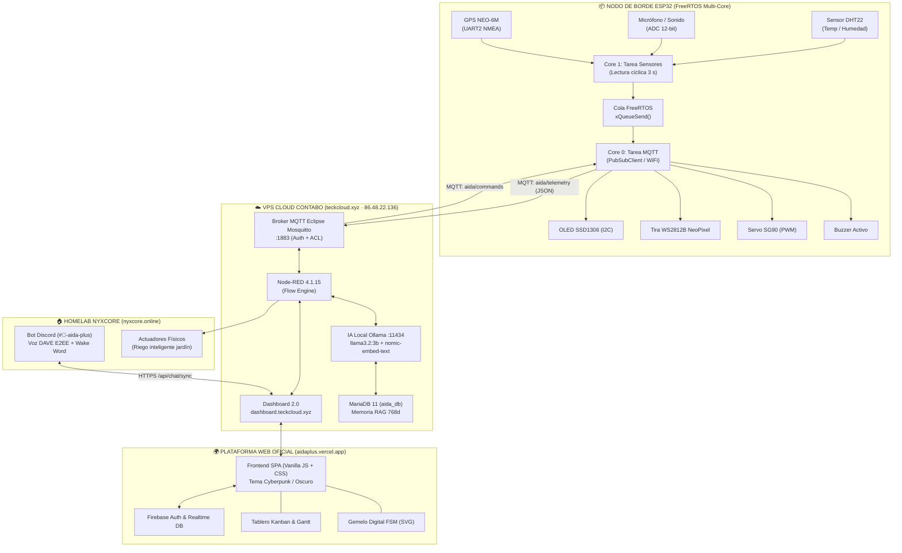

# 🧠 AIDA+ — Asistente Inteligente Descentralizado y Adaptable

<div align="center">


[](https://aidaplus.vercel.app)
[](https://dashboard.teckcloud.xyz)
[](content/firmware/)
[](content/network/)
[](https://aida.teckcloud.xyz)
[](LICENSE)

**Proyecto de Semestre — Tecsup · Administración de Redes y Comunicaciones · Ciclo VI**  
*Implementación de Tecnologías Emergentes, Edge AI, IoT Distribuido y Memoria Semántica RAG*

</div>

---

## 🌐 Enlaces y Portales Web Oficiales

| Portal / Servicio | Enlace Directo | Descripción |
| :--- | :--- | :--- |
| 🚀 **Portal Web Oficial (Vercel)** | [**aidaplus.vercel.app**](https://aidaplus.vercel.app) | Plataforma SPA oficial de seguimiento del proyecto, tablero Kanban interactivo, cronograma Gantt y gemelo digital FSM. |
| 📊 **Dashboard IoT en Vivo** | [**dashboard.teckcloud.xyz**](https://dashboard.teckcloud.xyz) | Panel de telemetría en tiempo real, gauges de sensores, mapa GPS, control de actuadores y buscador de memoria RAG. |
| ⚡ **Node-RED Flow Manager** | [**aida.teckcloud.xyz**](https://aida.teckcloud.xyz) | Orquestador central de lógica, integración de eventos MQTT y comunicación con modelos de lenguaje. |
| 🗄️ **Base de Datos MariaDB** | [**db.teckcloud.xyz/pma/**](https://db.teckcloud.xyz/pma/) | Administración web (phpMyAdmin) de base de datos relacional y embeddings vectoriales de 768 dimensiones. |
| 🏠 **Homelab Maestro NYXCORE** | [**nyxcore.online**](https://nyxcore.online) | Servidor doméstico puente de hardware, domótica, actuadores y bot de voz interactivo en Discord (`#🧠-aida-plus`). |
| 🎮 **Simulación ESP32 en Wokwi** | [**Guía de Simulación Wokwi**](content/hardware/WOKWI.md) | Diagrama esquemático interactivo y simulación de firmware en la nube. |

---

## 📋 Resumen del Proyecto

**AIDA+** es un ecosistema ciberfísico distribuido que integra computación de borde (**Edge Computing**), mensajería en tiempo real (**MQTT**) e **Inteligencia Artificial Local** asistida por memoria semántica (**RAG**).

El núcleo del asistente está compuesto por un nodo de borde **ESP32** ejecutando **FreeRTOS** multi-núcleo, el cual interactúa bidireccionalmente con un clúster híbrido formado por un **VPS Cloud Contabo** (cerebro de inferencia y bases de datos) y el servidor doméstico **NYXCORE** (puente de audio Discord con cifrado DAVE E2EE y actuadores domóticos).

---

## 🏗️ Arquitectura Integral del Sistema



---

## ⚙️ Especificaciones de Hardware & Pinout (ESP32)

| Componente | Tipo | Pin ESP32 (GPIO) | Protocolo / Función |
| :--- | :--- | :--- | :--- |
| **DHT22 (AM2302)** | Sensor | `GPIO 4` | Bus digital único (Temperatura -40..80°C, Humedad 0..100%) |
| **Micrófono / Sensor Sonido** | Sensor | `GPIO 34` | Entrada analógica ADC1 (Nivel de ruido ambiental en dB) |
| **GPS NEO-6M** | Sensor | `GPIO 16 (RX2)`, `GPIO 17 (TX2)` | UART2 Serial a 9600 baudios (Latitud, Longitud, Altitud, Satélites) |
| **Pantalla OLED SSD1306** | Actuador | `GPIO 21 (SDA)`, `GPIO 22 (SCL)` | I2C (128x64 px, visualización de estados y métricas) |
| **Tira NeoPixel WS2812B** | Actuador | `GPIO 18` | Señal One-Wire DIN (Indicador RGB del estado de ánimo y alertas) |
| **Servomotor SG90** | Actuador | `GPIO 19` | Señal PWM 50 Hz (Ángulo de inclinación / interacción física 0..180°) |
| **Buzzer** | Actuador | `GPIO 23` | Señal digital / PWM (Alertas sonoras y tonos de retroalimentación) |

---

## 📡 Contratos MQTT (Tópicos & Payloads JSON)

### 1. Telemetría de Subida (`aida/telemetry`)
Publicado periódicamente cada 3 segundos desde el ESP32 hacia el broker:
```json
{
  "device": "esp32_aida_node",
  "uptime_s": 1420,
  "sensors": {
    "temperature": 22.4,
    "humidity": 58.2,
    "sound_level": 42.1,
    "gps": {
      "lat": -16.409047,
      "lon": -71.537451,
      "satellites": 7,
      "valid": true
    }
  },
  "state": "IDLE",
  "free_heap": 184520
}
```

### 2. Comandos de Bajada (`aida/commands`)
Enviado desde el Dashboard Node-RED, Web o Bot de Discord hacia el ESP32:
```json
{
  "state": "ALERT",
  "servo_angle": 90,
  "rgb": { "r": 0, "g": 242, "b": 254 },
  "buzzer": { "beep": true, "duration_ms": 250 }
}
```

---

## 📂 Estructura del Repositorio

```text
├── .github/                 # Workflows y configuración de GitHub
├── content/
│   ├── firmware/            # Código fuente PlatformIO C++ para ESP32
│   ├── hardware/            # Diagramas esquemáticos Wokwi y guía de conexión
│   ├── network/             # Guías de despliegue en VPS, configuración Mosquitto y flujos JSON
│   └── uml/                 # Diagramas de arquitectura, bloques, estados y secuencia
├── docs/                    # Bóveda de documentación técnica detallada (Obsidian / MOC)
│   ├── 00 - Inicio (MOC).md
│   ├── 01 - Arquitectura General.md
│   ├── 02 - Gemelo Digital (FSM).md
│   ├── 06 - Deploy (Vercel).md
│   └── ...
├── public/                  # Aplicación Web SPA oficial (HTML5 / Vanilla CSS / JS)
│   ├── index.html           # Portal interactivo principal
│   ├── app.js               # Lógica de cliente, Firebase Auth & Realtime Database
│   ├── aida-twin.js         # Motor SVG del Gemelo Digital
│   └── styles.css           # Sistema de diseño Cyberpunk / Neon
├── Lab 9 Tarea/             # Tareas e informes de laboratorio
├── Lab09 - Subida del proyecto.docx.md # Informe técnico académico completo
├── netlify.toml             # Configuración de respaldo Netlify
├── package.json             # Scripts de previsualización local
├── vercel.json              # Configuración de cabeceras y redirecciones para Vercel
└── README.md                # Documento maestro del proyecto
```

---

## 🚀 Guía de Puesta en Marcha

### 1. Visualización del Portal Web
El portal está completamente configurado para despliegue estático sin etapa de compilación:
```bash
# Servidor local de desarrollo
npm run dev
# Abrir en navegador: http://localhost:3000
```
*Cada cambio enviado a la rama `main` de este repositorio se compila y publica automáticamente en [aidaplus.vercel.app](https://aidaplus.vercel.app).*

### 2. Compilación del Firmware (ESP32)
1. Copia la plantilla de credenciales:
   ```bash
   cp content/firmware/secrets.example.h include/secrets.h
   ```
2. Completa tus credenciales de red WiFi y broker MQTT en `include/secrets.h`.
3. Compila y sube el firmware con PlatformIO:
   ```bash
   pio run --target upload
   ```

---

## 👥 Equipo de Trabajo — Tecsup ARC Ciclo VI

| Integrante | Rol en el Proyecto | Especialidad |
| :--- | :--- | :--- |
| **Torres Salazar, Uriel Aron (Nyxthorn)** | Líder de Proyecto · Firmware ESP32 | FreeRTOS, Edge AI, Arquitectura RAG y Servidores |
| **Mancha Vilca, Magaly Yulisa** | Infraestructura Cloud · Node-RED | Despliegue de Servidores, Flujos y Automatización |
| **Ccarita Apaza, Paola** | Dashboard · Documentación | Interfaces de Usuario, Telemetría y Pruebas |
| **Canaza Viza, Xavi Andre** | Hardware & Simulación | Sensores, Actuadores y Entorno Wokwi |
| **Ramos Choque, Alexis** | Integración MQTT · Portal de Evidencias | Redes IoT, Conectividad y Pruebas de Carga |

---

<div align="center">
  <sub>Desarrollado para la carrera de <b>Administración de Redes y Comunicaciones</b> — Tecsup Arequipa 2026.</sub>
</div>