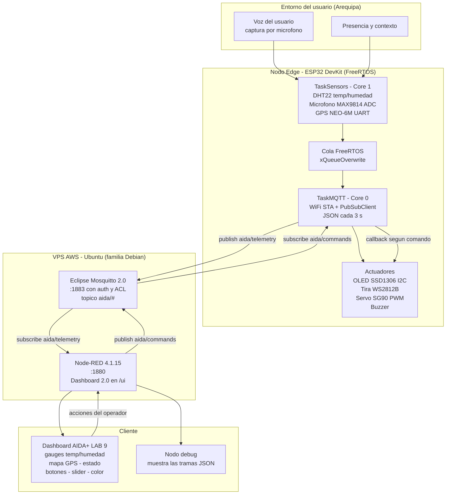
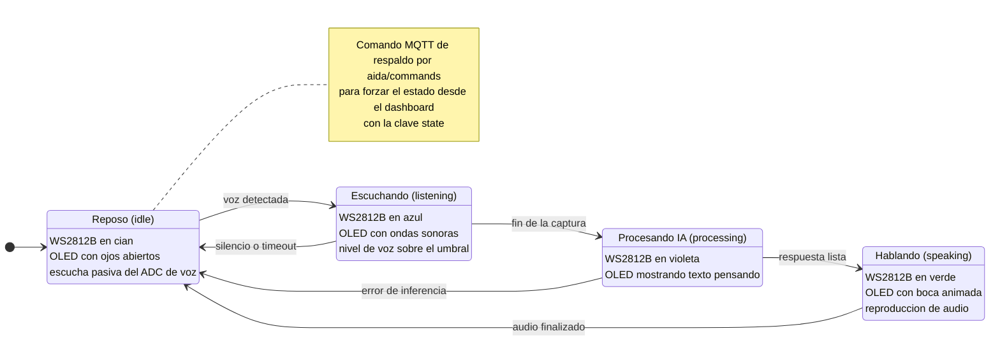
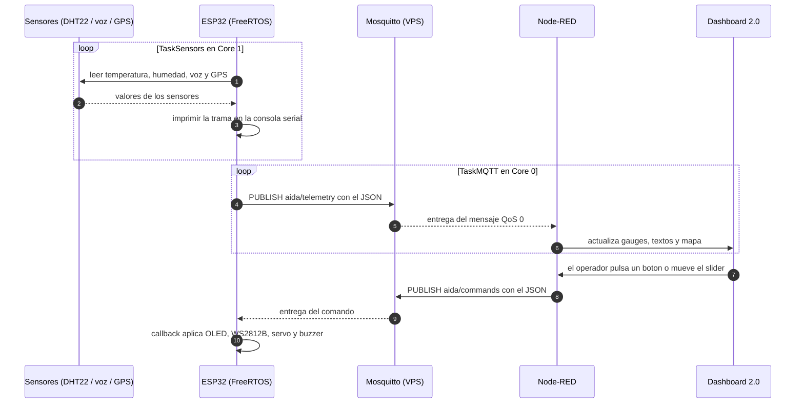

# Diagramas UML — AIDA+ Laboratorio 9

Diagramas del proyecto de semestre, en formato **Mermaid**. Los archivos `.mmd` son el
código fuente (se abren en [Mermaid Live](https://mermaid.live), Obsidian o VS Code con
la extensión *Markdown Preview Mermaid Support*); esta página los muestra ya renderizados
en GitHub.

| Diagrama | Archivo | Qué responde |
|---|---|---|
| Bloques | [`uml_aida_bloques.mmd`](./uml_aida_bloques.mmd) | ¿Qué componentes hay y cómo se conectan? |
| Flujo de estados | [`uml_aida_flujo_estados.mmd`](./uml_aida_flujo_estados.mmd) | ¿Qué estados tiene el asistente y qué los cambia? |
| Secuencia | [`uml_aida_secuencia.mmd`](./uml_aida_secuencia.mmd) | ¿En qué orden viajan los mensajes entre ESP32, broker y dashboard? |

---

## 1. Diagrama de bloques

## 2. Diagrama de flujo de estados

## 3. Diagrama de secuencia

