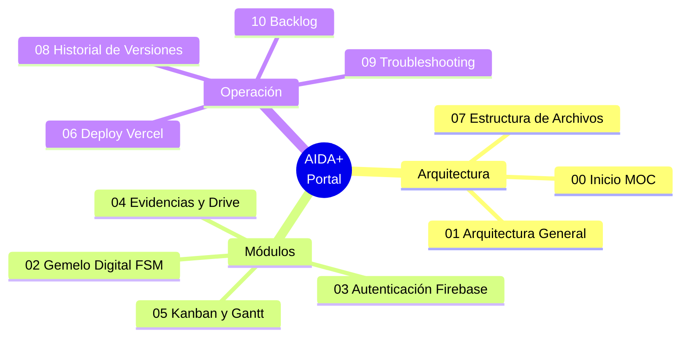

# 🧠 AIDA+ — Portal de Seguimiento (Hito N° 2)

> [!info] Ficha rápida
> **Cliente:** Tecsup Arequipa — Ciclo VI · IoT / Edge AI
> **Live:** https://aidaplus.vercel.app
> **Repo:** https://github.com/xllnyxthornllx/AIDA- (`main`)
> **Stack:** Vanilla JS · Firebase Auth + RTDB · Google Drive API · Vercel
> **Versión actual:** `v16`
> **Docente auditor:** `rllerenad@tecsup.edu.pe`

#aida #moc #tecsup #iot

---

## 🗺️ Mapa de Contenido (MOC)

## 📚 Notas del Vault

| # | Nota | Contenido |
|---|---|---|
| 00 | **[[00 - Inicio (MOC)]]** | Este índice |
| 01 | **[[01 - Arquitectura General]]** | Diagrama de sistema, stack, flujo de datos |
| 02 | **[[02 - Gemelo Digital (FSM)]]** | Máquina de estados, animaciones OLED/LED |
| 03 | **[[03 - Autenticación Firebase]]** | Auth email/Google, reglas RTDB, usuarios |
| 04 | **[[04 - Evidencias y Google Drive]]** | Subida a Drive, scope, carpeta, flujo |
| 05 | **[[05 - Kanban y Gantt]]** | Tablero, cronograma, modelo de tareas |
| 06 | **[[06 - Deploy (Vercel)]]** | CI/CD, configuración, cache-busting |
| 07 | **[[07 - Estructura de Archivos]]** | Árbol de carpetas y responsabilidades |
| 08 | **[[08 - Historial de Versiones]]** | Bitácora v1 → v16 |
| 09 | **[[09 - Troubleshooting]]** | Errores conocidos y soluciones |
| 10 | **[[10 - Backlog y Pendientes]]** | Roadmap y bugs abiertos |

---

## ⚡ Resumen en 30 segundos

Portal estático (sin build) que reemplaza a Trello para el **Hito N° 2** del proyecto AIDA+
(Asistente Inteligente Descentralizado y Adaptable). Muestra:

- 📊 **Gantt** — 5 fases repartidas en 6 semanas
- 🗂️ **Kanban** — Backlog / En Proceso / En Validación / Completado (drag & drop)
- 📁 **Evidencias** — subida a Google Drive Pro del equipo + links
- 👥 **Equipo** — 5 integrantes con roles
- 🤖 **Gemelo Digital** — rostro animado del nodo Edge AI (OLED + WS2812B)
- 🔐 **Auth** — Firebase (lectura pública, escritura autenticada)

## 👥 Equipo

| Integrante | Rol |
|---|---|
| Uriel Aron Torres Salazar | Líder / Edge AI |
| Magaly Yulisa Mancha Vilca | Hardware / Periféricos |
| Paola Ccarita Apaza | Redes IoT / MQTT |
| Alexis Ramos Choque | IA / Firmware |
| Xavi Andre Canaza Viza | Pruebas / Docs |

Ver: [[01 - Arquitectura General]] →
