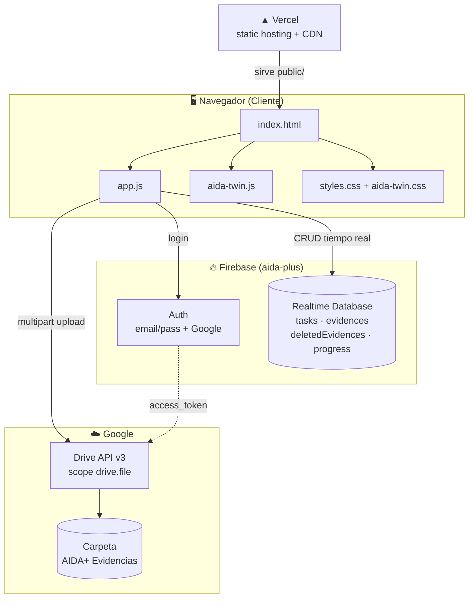
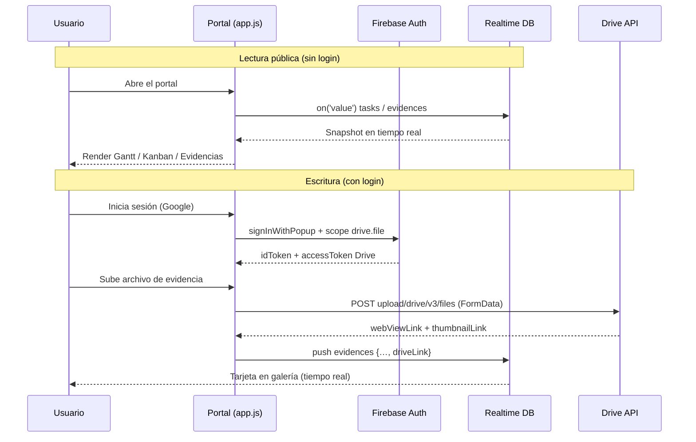

# 🏗️ Arquitectura General

[[00 - Inicio (MOC)]] · [[07 - Estructura de Archivos]] · [[06 - Deploy (Vercel)]]

#aida #arquitectura

---

## Vista de alto nivel

---

## Principios de diseño

> [!abstract] Reglas de oro
> 1. **Sin build step** — HTML/CSS/JS estáticos servidos directos (`public/`).
> 2. **Sin frameworks** — Vanilla JS ES6, cero dependencias npm en runtime.
> 3. **Lectura pública, escritura autenticada** — reglas RTDB `auth != null`.
> 4. **Costo cero** — Vercel free + Firebase Spark + Drive Pro (ya pagado).
> 5. **Cache-busting** — `?v=N` en cada asset para evitar versiones viejas.

---

## Flujo de datos (lectura / escritura)

---

## Módulos JS

| Módulo | Rol | Global |
|---|---|---|
| `app.js` | Render, auth, Kanban DnD, evidencias, modales, efectos | — |
| `aida-twin.js` | Gemelo Digital (FSM) | `window.AidaTwin` |
| `firebase-config.js` | Config Firebase (datos) | `firebaseConfig`, `FIREBASE_ENABLED` |

Ver detalle: [[03 - Autenticación Firebase]], [[04 - Evidencias y Google Drive]], [[02 - Gemelo Digital (FSM)]].

---

## Datos del proyecto

```mermaid
gantt
    title Fases del proyecto (6 semanas)
    dateFormat X
    axisFormat S%s
    section F1 Concepto
    Diseño e Ingeniería    :f1, 1, 2
    section F2 Hardware
    Desarrollo HW          :f2, 2, 3
    section F3 Redes
    Infraestructura IoT    :f3, 3, 4
    section F4 IA
    Integración IA         :f4, 4, 5
    section F5 Cierre
    Pruebas y Docs         :f5, 5, 6
```

| Fase | Semanas | Responsables |
|---|---|---|
| F1 Diseño e Ingeniería Conceptual | S1–S2 | Uriel, Magaly |
| F2 Desarrollo de Hardware y Periféricos | S2–S3 | Alexis, Xavi, Uriel |
| F3 Redes e Infraestructura IoT | S3–S4 | Paola, Alexis, Magaly |
| F4 Integración con IA y Automatización | S4–S5 | Uriel, Magaly, Xavi |
| F5 Pruebas, Video y Documentación | S5–S6 | Todo el equipo |
