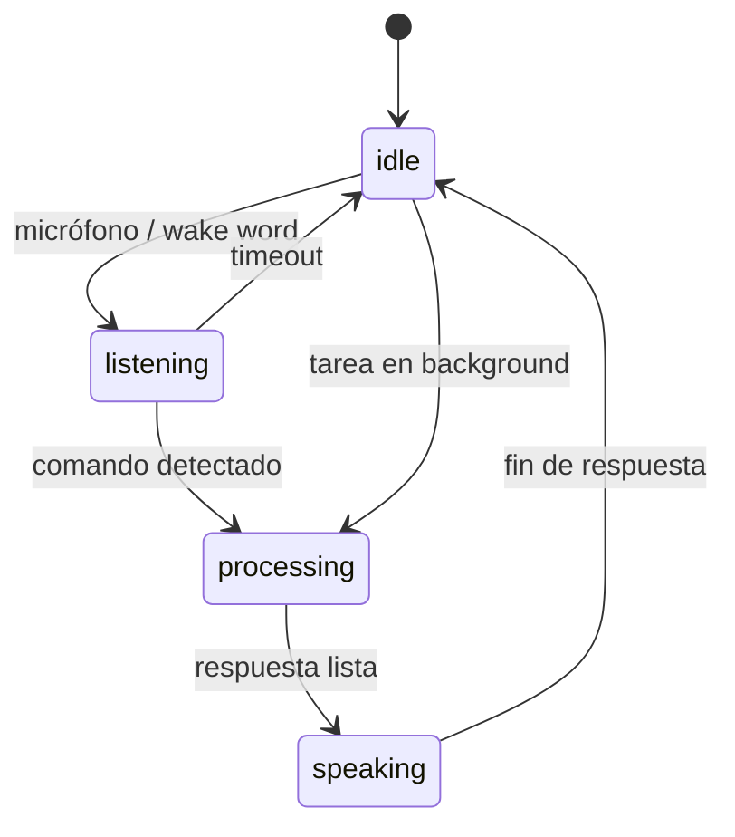
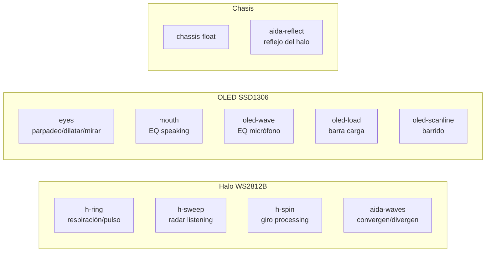
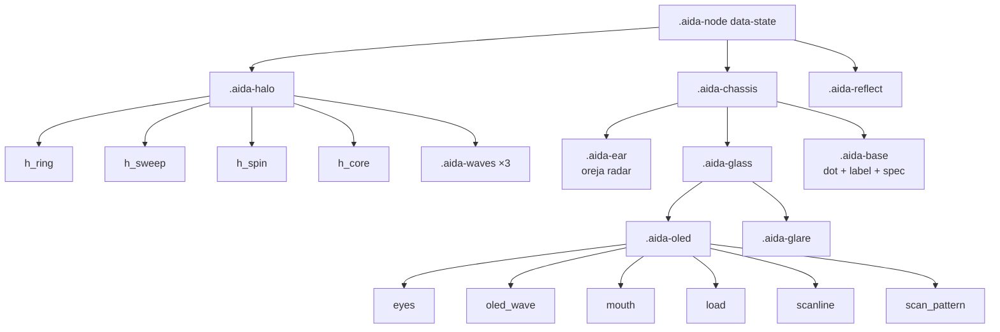

# 🤖 Gemelo Digital (FSM)

[[00 - Inicio (MOC)]] · [[01 - Arquitectura General]] · [[07 - Estructura de Archivos]]

#aida #gemelo-digital #fsm

> [!tip] Concepto
> El Gemelo Digital NO es un logo: es la simulación del hardware físico de AIDA+ —
> pantalla **OLED SSD1306** (ojos/boca), tira **WS2812B** (halo LED) y chasis mate
> bajo cristal. Implementado como clase ES6 aislada `AidaDigitalTwin`.

**Archivos:** `public/aida-twin.js` (lógica) + `public/aida-twin.css` (visual)
**Montaje:** `<div id="aida-twin-mount">` en el hero de `index.html`
**API global:** `window.AidaTwin` → `setState(state)`, `onState(fn)`, `startAuto()`, `stopAuto()`

---

## Máquina de Estados (FSM)



| Estado | Color halo (WS2812B) | OLED (SSD1306) |
|---|---|---|
| `idle` | 🟦 `#00FFFF` cian — respiración 4.2s | Parpadeo asíncrono (delay .12s) |
| `listening` | 🟦 `#0055FF` azul — expandido + radar | Ojos arriba + **oreja radar** + EQ micrófono 9 barras |
| `processing` | 🟪 `#b026ff` violeta — anillo rotando | Ojos en barrido + barra de carga + scanline |
| `speaking` | 🟩 `#00ff88` verde agua — pulsos | Ojos felices + ecualizador de 5 barras |

---

## Animaciones por capa



### Detalle de keyframes

| Keyframe | Uso | Propiedades (GPU) |
|---|---|---|
| `halo-breathe` | idle / processing | opacity, scale |
| `halo-pulse` | speaking | opacity, scale |
| `halo-spin` | processing (rueda), listening (radar) | rotate |
| `eye-blink` | idle / listening | scaleY |
| `eye-scan` | processing | translateX |
| `eye-happy` | speaking | scaleY |
| `mouth-eq` | speaking | height |
| `mic-eq` | listening | height |
| `oled-loading` | processing | margin-left |
| `scan-sweep` | processing | translateX |
| `chassis-float` | todos | translateY |
| `wave-in` | listening (audio entra) | scale, opacity |
| `wave-out` | speaking (audio sale) | scale, opacity |
| `sig-in` | oreja radar | scale, opacity |

---

## Render del componente



---

## Rendimiento y accesibilidad

> [!success] Optimización GPU
> - Capas intensivas con `will-change: transform, filter, opacity` + `translateZ(0)`
> - Solo se animan **transform / opacity / filter** → sin layout thrash
> - `@media (prefers-reduced-motion: reduce)` desactiva **todas** las animaciones y el AUTO

> [!note] Accesibilidad
> - `role="img"` con `aria-label` **dinámico según estado**
> - Botones FSM con `aria-pressed`
> - Caption con `aria-live="polite"`

---

## Integración con telemetría (futuro)

`window.AidaTwin` está listo para conectar MQTT/WebSocket:

```js
// Desde telemetría real del ESP32
window.AidaTwin.setState('listening'); // cuando detecta voz
window.AidaTwin.setState('processing'); // mientras procesa
window.AidaTwin.setState('speaking');   // al responder
window.AidaTwin.onState((next, prev) => console.log(prev, '→', next));
```

> [!warning] Reflejo en el dashboard
> El estado actual pinta `--aida-glow` en `:root`, que tiñe el `box-shadow`
> de las tarjetas Kanban → inmersión 3D.

Ver también: [[05 - Kanban y Gantt]].
