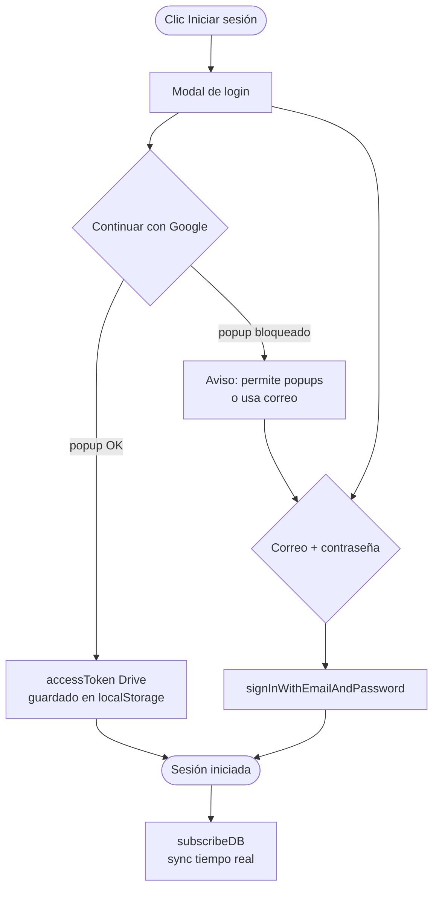
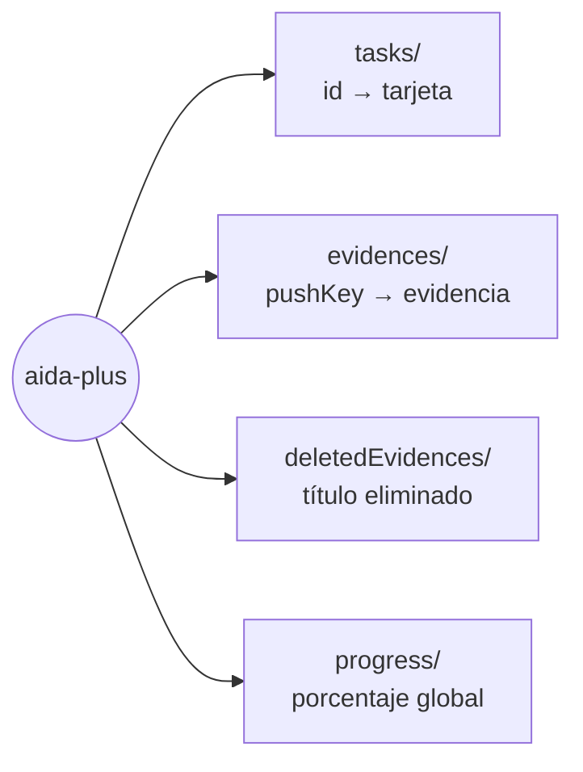

# 🔐 Autenticación Firebase

[[00 - Inicio (MOC)]] · [[04 - Evidencias y Google Drive]] · [[01 - Arquitectura General]]

#aida #firebase #auth

> [!info] Resumen
> **Proyecto Firebase:** `aida-plus`
> **RTDB:** `https://aida-plus-default-rtdb.firebaseio.com`
> **Reglas:** lectura pública, escritura autenticada
> **Métodos:** Email/Password + Google (con scope `drive.file`)

---

## Modelo de permisos

```mermaid
graph TD
    ANON[👤 Anónimo] -->|READ| TODO[Todo el contenido]
    USER[🔑 Usuario logueado] -->|WRITE| TASKS[tasks Kanban]
    USER -->|WRITE| EV[evidences]
    USER -->|DELETE| EV
    USER -->|WRITE| PROG[progress]
    ANON -.X.->|BLOQUEADO| TASKS
```

```json
{
  "rules": {
    ".read": true,
    ".write": "auth != null"
  }
}
```

---

## Flujo de login



> [!warning] Popup vs Redirect
> - Se usa **solo popup**. El `signInWithRedirect` se eliminó porque falla en Firefox
>   con *storage partitioning* (`missing initial state`).
> - Si el navegador bloquea popups → se guía al usuario al login por **correo**.

---

## Usuarios del equipo

| Correo | Password | Estado |
|---|---|---|
| `alexis.ramos@tecsup.edu.pe` | `${AIDA_TEAM_PASSWORD}` | ✅ Activa |
| `magaly.mancha@tecsup.edu.pe` | `${AIDA_TEAM_PASSWORD}` | ✅ Activa |
| `paola.ccarita@tecsup.edu.pe` | `${AIDA_TEAM_PASSWORD}` | ✅ Activa |
| `andree.canaza@tecsup.edu.pe` | `${AIDA_TEAM_PASSWORD}` | ✅ Activa |
| `uriel.torres@tecsup.edu.pe` | — | ⚠️ Preexistente, requiere reset/recrear |

> [!danger] Seguridad
> - **Nunca** commitear `${AIDA_TEAM_PASSWORD}` ni `${FIREBASE_API_KEY}`.
> - La API key de Firebase **es pública por diseño** (web), pero va referenciada.
> - Rotar tokens de GitHub tras exponerlos.

---

## Dominios autorizados

`localhost` · `aida-plus.web.app` · `aida-plus.netlify.app` · `aidaplus.vercel.app` ·
`aidaplus-duxgaicmu-xllnyxthornllxs-projects.vercel.app`

---

## Google OAuth — scope Drive

Ver: [[04 - Evidencias y Google Drive]] para la configuración del scope `drive.file`.

- **Google Cloud Console → Pantalla de consentimiento OAuth → "Acceso a los datos"**
- Scope agregado: `https://www.googleapis.com/auth/drive.file`
- App en modo **Pruebas** → añadir los 5 correos como *Usuarios de prueba*.

---

## Nodos en Realtime Database



| Nodo | Escritura | Notas |
|---|---|---|
| `tasks` | logueado | Kanban (ver [[05 - Kanban y Gantt]]) |
| `evidences` | logueado | Ver [[04 - Evidencias y Google Drive]] |
| `deletedEvidences` | logueado | Filtro anti-resurrección |
| `progress` | logueado | % avance global |
