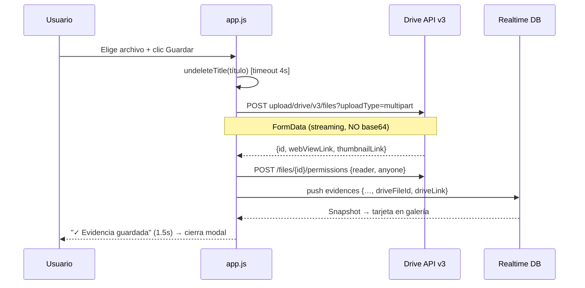

# 📁 Evidencias y Google Drive

[[00 - Inicio (MOC)]] · [[03 - Autenticación Firebase]] · [[09 - Troubleshooting]]

#aida #drive #evidencias

> [!info] Objetivo
> Repositorio de evidencias del proyecto. Soporta **subida directa de archivos** a la
> carpeta Drive Pro del equipo, además de **links** (Drive, URL de imagen, PDF).

---

## Configuración Drive

| Parámetro | Valor |
|---|---|
| **Scope** | `https://www.googleapis.com/auth/drive.file` (no sensible) |
| **Carpeta** | `AIDA+ Evidencias` |
| **Folder ID** | `1NqH5rjOn1dDncJL-DzJPYLOADD9VcEEx` |
| **Cuenta** | Google Drive Pro del equipo (ya pagado, costo $0 extra) |
| **Límite archivo** | 25 MB por archivo (validado en cliente) |

> [!tip] ¿Por qué `drive.file` y no `drive`?
> `drive.file` solo accede a los archivos que la app crea — **no** requiere verificación
> de Google (no sensible). `drive` (acceso total) sería sensible y exigiría auditoría.

---

## Flujo de subida



---

## Tipos de evidencia

```mermaid
graph TD
    IMG[Evidencia] --> FILE{¿Archivo o link?}
    FILE -->|Archivo subido| D1[Drive: thumbnailLink<br/>miniatura + lightbox]
    FILE -->|Link archivo Drive| D2[/file/d/ID → thumbnail?id=ID]
    FILE -->|Link carpeta Drive| D3[/drive/folders/ID<br/>tarjeta Abrir carpeta]
    FILE -->|URL imagen directa| D4[img src]
    FILE -->|URL documento| D5[tarjeta DOC + enlace]
```

---

## Modelo de datos (RTDB `evidences/{pushKey}`)

```json
{
  "title": "Prueba OLED SSD1306",
  "desc": "Montaje en protoboard",
  "tag": "Hardware",
  "img": "<thumbnailLink o webViewLink>",
  "driveFileId": "1AbC...",
  "driveLink": "https://drive.google.com/file/d/.../view",
  "fileName": "foto_oled.png",
  "by": "alexis.ramos@tecsup.edu.pe",
  "at": 1791354133296
}
```

---

## Anti-bugs críticos

> [!bug] Bug 1 — Evidencia "fantasma" (aparecía y se borraba)
> El filtro `deletedEvidences` ocultaba una evidencia cuyo título coincidía con uno
> previamente eliminado. **Solución (v14):** `undeleteTitle()` borra el registro de
> `deletedEvidences` al guardar → la evidencia "resucita".

> [!bug] Bug 2 — Pestaña se cerraba al subir
> El método antiguo convertía el archivo a **base64 en memoria** (un PNG de 10 MB → ~50 MB
> de strings) y tumbaba la pestaña. **Solución (v15):** subida por **streaming `FormData`**.

> [!bug] Bug 3 — "Entra con Google" aunque la sesión fuera de Google
> El token se guardaba en `sessionStorage`, que muere entre pestañas/recargas.
> **Solución (v13):** token en `localStorage` + botón **Reconectar Drive**.

---

## Diagnóstico (v16)

Logs en consola con breadcrumbs:

| Log | Significa |
|---|---|
| `[Evidence] submit: título …` | El clic llegó al handler |
| `[Drive] subiendo: nombre KB` | Hay token y arranca la subida |
| `[Drive] archivo creado: id` | Drive aceptó el archivo |
| `[Evidence] push ok` | Guardado en RTDB |
| `[Evidence] fallo: …` | Error (ver detalle) |
| `[Drive] 401/403` | Token inválido → Reconectar Drive |

> [!question] Estado actual (bug abierto)
> El usuario reporta que tras **Guardar** no ve confirmación. Pendiente recibir los logs
> `[Drive]`/`[Evidence]` para cerrar el diagnóstico. Ver [[10 - Backlog y Pendientes]].

---

## Botones en el modal

| Elemento | Función |
|---|---|
| `#ev-file` | Selector de archivo (imagen, PDF, doc, zip, mp4…) |
| `#drive-conn` | Estado: "Drive conectado ✓" o instrucciones |
| `#drive-reconnect` | Logout + relogin Google con scope (mismo gesto) |
| `#drive-status` | Barra de progreso + confirmación dentro del modal |
| `#ev-save` | Guardar (se desactiva mientras sube) |
