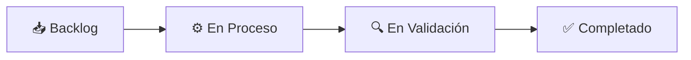
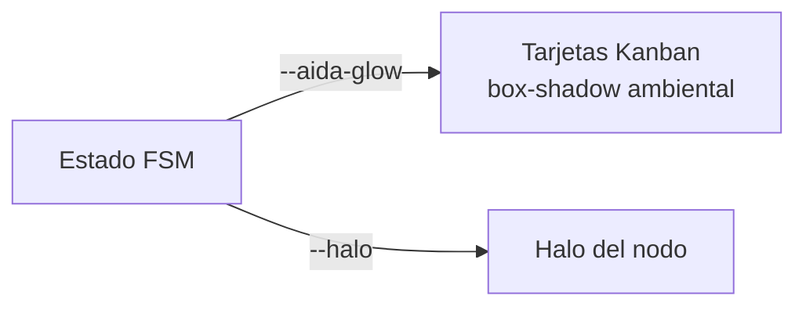

# 🗂️ Kanban y Gantt

[[00 - Inicio (MOC)]] · [[02 - Gemelo Digital (FSM)]] · [[01 - Arquitectura General]]

#aida #kanban #gantt

---

## Kanban — 4 columnas



| Columna | Clave | Color |
|---|---|---|
| Backlog | `backlog` | gris `#64748b` |
| En Proceso | `proceso` | ámbar `#f59e0b` |
| En Validación | `validacion` | violeta `#a78bfa` |
| Completado | `completado` | verde `#22c55e` |

### Tarjetas iniciales

| ID | Título | Asignado | Columna |
|---|---|---|---|
| `F1-01` | Levantamiento de Requerimientos | Uriel Torres | validacion |
| `F1-02` | Diagramas de Arquitectura | Magaly Mancha | completado |
| `F1-03` | Modelado Digital 3D de AIDA+ | Paola Ccarita | proceso |
| `F2-01` | Firmware base ESP32 y FreeRTOS | Alexis Ramos | proceso |
| `F2-02` | Integración OLED SSD1306 y WS2812B | Xavi Canaza | backlog |
| `F3-02` | Configuración MQTT y Webhooks | Paola Ccarita | backlog |

### Modelo de tarea (RTDB `tasks/{id}`)

```json
{ "id": "F1-01", "title": "Levantamiento de Requerimientos",
  "assignee": "Uriel Torres", "col": "validacion" }
```

> [!tip] Funciones del tablero
> Drag & drop entre columnas (solo logueados) · búsqueda · filtro por asignado/columna ·
> export JSON · edición por modal · sincronización en tiempo real vía `on('value')`.

---

## Gantt — 5 fases / 6 semanas

```mermaid
gantt
    title Cronograma Hito N° 2
    dateFormat X
    axisFormat S%s
    section F1 · Concepto
    Diseño e Ingeniería Conceptual :1, 2
    section F2 · Hardware
    Desarrollo Hardware y Periféricos :2, 3
    section F3 · Redes
    Redes e Infraestructura IoT :3, 4
    section F4 · IA
    Integración con IA :4, 5
    section F5 · Cierre
    Pruebas, Video y Documentación :5, 6
```



| Fase | Semanas | Responsables |
|---|---|---|
| F1 Diseño e Ingeniería Conceptual | S1–S2 | Uriel, Magaly |
| F2 Desarrollo de Hardware y Periféricos | S2–S3 | Alexis, Xavi, Uriel |
| F3 Redes e Infraestructura IoT | S3–S4 | Paola, Alexis, Magaly |
| F4 Integración con IA y Automatización | S4–S5 | Uriel, Magaly, Xavi |
| F5 Pruebas, Video y Documentación | S5–S6 | Todo el equipo |

> [!note] Barras animadas
> Las barras del Gantt crecen con `transition: width/left 1.1s` al entrar al viewport
> (IntersectionObserver).

---

## Progreso global

- Barra animada + control numérico (`#progress-input` + botón Actualizar).
- Se guarda en RTDB `progress`; valor inicial mostrado: **35%**.

---

## Relación con el Gemelo Digital

El estado del Gemelo Digital tiñe las tarjetas Kanban vía `--aida-glow`:



Ver [[02 - Gemelo Digital (FSM)]].

---

## Backlog — Kanban Avanzado (#3)

Pendiente de implementar:

- [ ] Fechas límite (`dueDate`) + badge "vencida"
- [ ] Prioridad: `baja` / `media` / `alta` / `critica` (colores)
- [ ] Etiquetas personalizadas (`tags[]`)
- [ ] Multi-asignación (`assignees[]`)
- [ ] Filtros por prioridad / etiqueta / asignado / vencidas
- [ ] Orden persistente dentro de columna (`order`)

Ver [[10 - Backlog y Pendientes]].
