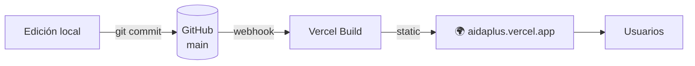
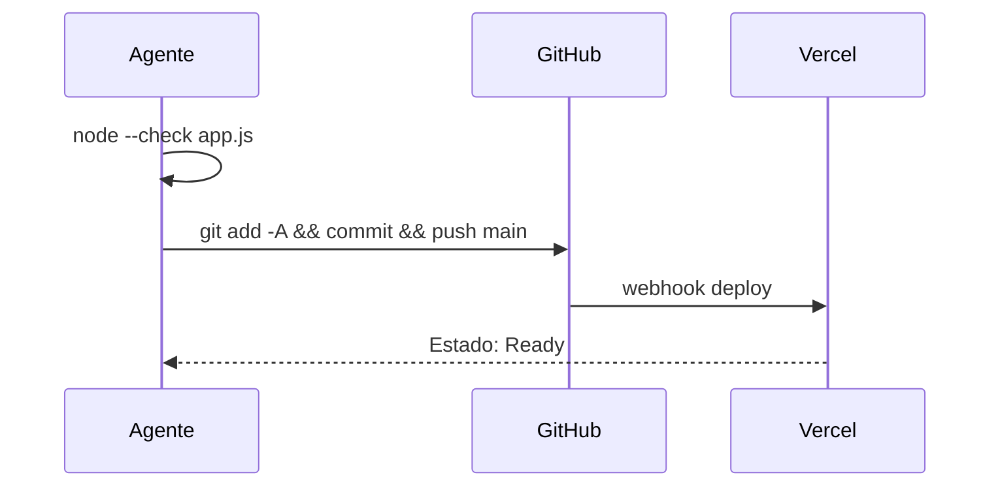
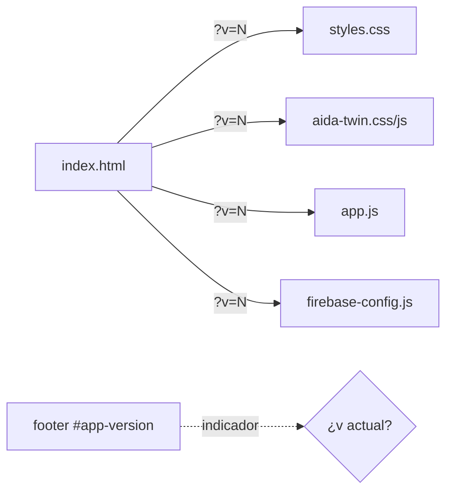

# 🚀 Deploy (Vercel)

[[00 - Inicio (MOC)]] · [[01 - Arquitectura General]] · [[09 - Troubleshooting]]

#aida #deploy #vercel

> [!info] Estrategia
> Sitio **estático** en `public/`, **sin build step**. Vercel auto-deploya al hacer
> `git push origin main`. Cache-busting con `?v=N`.

---

## Pipeline





---

## Configuración Vercel

**Proyecto:** `aida-plus` (framework "Other")
**Root Directory:** `public` · **Build Command:** ninguno · **Output:** `public/`

```json
// vercel.json
{
  "rewrites": [{ "source": "/(.*)", "destination": "/index.html" }],
  "headers": [{
    "source": "/(.*)",
    "headers": [
      { "key": "X-Content-Type-Options", "value": "nosniff" },
      { "key": "Referrer-Policy", "value": "strict-origin-when-cross-origin" }
    ]
  }]
}
```

> [!danger] NO agregar
> `"functions": { "nodeVersion": "..." }` → Vercel lo rechaza
> (`functions.nodeVersion should be object`). Se eliminó y se mantiene fuera.

---

## Cache-busting



- Cada release incrementa `?v=N` en **todos** los assets.
- El **footer** muestra `vN` (`<span id="app-version">`).
- Si el footer no muestra la versión esperada → el navegador tiene caché vieja.
- **ServiceWorker eliminado** y desregistrado en cada carga (causaba servir archivos viejos).

---

## Comandos

```bash
# Validar antes de subir
node --check public/app.js
node --check public/aida-twin.js

# Deploy
git add -A
git commit -m "tipo: descripción"
git push origin main

# Servir local
npx serve public
```

---

## Historial de URLs

| Etapa | Host |
|---|---|
| Inicial | Netlify (`aida-plus.netlify.app`) |
| Migración | Vercel (`aidaplus.vercel.app`) — Netlify abandonado |
| Preview URLs | `aidaplus-gs6bvj1g0-…`, `aidaplus-2w75ww3gf-…` (confundían testing) |

> [!warning] Al probar
> Usar siempre **https://aidaplus.vercel.app** en **incógnito sin extensiones**.
> Las preview URLs y el ServiceWorker causaban servir versiones antiguas.
