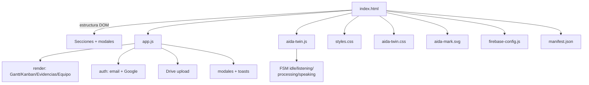

# 📂 Estructura de Archivos

[[00 - Inicio (MOC)]] · [[01 - Arquitectura General]] · [[06 - Deploy (Vercel)]]

#aida #estructura

---

## Árbol del repositorio

```
AIDA+/
├── public/                      # 🎯 Raíz servida por Vercel
│   ├── index.html               # Página única (todas las secciones + modales)
│   ├── app.js                   # Lógica: render, auth, Kanban, evidencias, Drive
│   ├── styles.css               # Tema oscuro/cian, layout, componentes
│   ├── aida-twin.js             # 🔷 Gemelo Digital (clase AidaDigitalTwin + FSM)
│   ├── aida-twin.css            # 🔷 Estilos del Gemelo Digital (halo, OLED)
│   ├── aida-mark.svg            # 🔷 Logotipo vectorial (header/favicon/manifest)
│   ├── firebase-config.js       # Config Firebase (datos, NO inicializa)
│   ├── manifest.json            # PWA manifest (standalone, iconos, shortcuts)
│   ├── vercel.json              # Copia de config (flexibilidad root)
│   ├── assets/images/           # Imágenes placeholder (render/architecture/wiring)
│   ├── data/                    # (vacío) datos estáticos futuros
│   └── docs/                    # (vacío) reservado
├── content/                     # Material del proyecto
│   ├── firmware/
│   ├── hardware/
│   └── network/
├── docs/                        # 📓 Este vault Obsidian
├── .github/                     # Workflows (si aplica)
├── .gitignore
├── LICENSE
├── README.md
├── package.json                 # build = echo (sin deps de runtime)
├── netlify.toml                 # Legado (Netlify abandonado)
└── vercel.json                  # Config raíz
```

---

## Responsabilidades por archivo



| Archivo | Responsabilidad | Tamaño aprox. |
|---|---|---|
| `index.html` | DOM completo, secciones, modales, scripts | ~230 líneas |
| `app.js` | Toda la lógica + Drive + auth | ~800 líneas |
| `styles.css` | Tema + layout + componentes | ~380 líneas |
| `aida-twin.js` | Gemelo Digital (clase ES6) | ~130 líneas |
| `aida-twin.css` | Animaciones del gemelo | ~200 líneas |
| `aida-mark.svg` | Logo vectorial | ~3 KB |

---

## Convenciones de código

- **Vanilla JS ES6** — sin frameworks, sin bundler.
- **Sin `export`** — scripts clásicos cargados con `<script defer>`.
- **IDs de DOM** — `ev-*` (evidencias), `auth-*` (auth), `task-*` (tareas), `drive-*` (Drive).
- **Prefijos CSS** — `.aida-*` (gemelo), `.brand-*` (marca).
- **Cache-busting** — `?v=N` sincronizado en los 5 assets + footer.

---

## Scripts cargados en index.html

```html
<!-- Orden de carga (defer = respeta orden) -->
firebase-app-compat.js
firebase-auth-compat.js
firebase-database-compat.js
firebase-config.js?v=N   <!-- datos -->
aida-twin.js?v=N         <!-- gemelo, auto-monta -->
app.js?v=N               <!-- lógica principal -->
```

> [!note] Firebase compat
> Se usa la SDK **compat** v10.12.2 (namespaced `firebase.auth()`, `firebase.database()`),
> no la modular, para simplificar en scripts clásicos.
