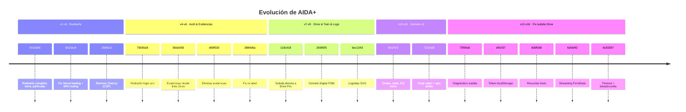
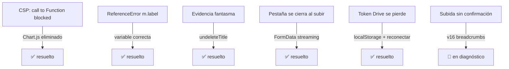

# 📅 Historial de Versiones

[[00 - Inicio (MOC)]] · [[09 - Troubleshooting]] · [[10 - Backlog y Pendientes]]

#aida #historial

> [!info] Versionado
> El número de versión (`?v=N` + footer) sirve de **cache-busting**. No hay semver formal:
> se incrementa con cada release significativo.

---

## Cronología de hitos

---

## Tabla de cambios (más reciente primero)

| Versión | Commit | Tipo | Descripción |
|---|---|---|---|
| **v16** | `6c83397` | fix | Timeout en `undeleteTitle` + breadcrumbs `[Drive]`/`[Evidence]` para diagnosticar subida |
| **v15** | `6e5b4f2` | fix | Subida Drive por **streaming FormData** (no tumba pestaña) + confirmación en modal |
| **v14** | `8d9f0d8` | fix | Resucitar título al guardar (evidencia aparecía y se borraba) + logs |
| **v13** | `ef0cf37` | fix | Token Drive en `localStorage` + fallback `result.credential` + botón Reconectar |
| **v12** | `75f99a5` | fix | Diagnóstico subida: estado conexión visible, errores con detalle, scroll rAF |
| **v11** | `722c5d5` | feat | Listening: ojos hacia arriba + oreja radar desplegable |
| **v10** | `65a7fc0` | feat | Gemelo v2: ondas convergentes/divergentes, radar, EQ micrófono, chasis flotante |
| **v9** | `bec1343` | feat | Logotipo AIDA+ en SVG (header con parpadeo, favicon, manifest) |
| **v8** | `26985f5` | feat | Gemelo Digital (FSM idle/listening/processing/speaking, halo + OLED, GPU) |
| **v7** | `118c918` | feat | Subida directa de evidencias a Drive Pro (scope drive.file + progreso) |
| **v6** | `3884d6a` | fix | `ReferenceError m.label` en `renderEvidences` (rompía galería y borrado) |
| **v5** | `145d43f` | chore | Cache-busting v5 + marcador de versión en footer |
| **v4** | `395e2e1` | fix | Carpetas Drive con etiqueta propia, anti doble-guardado, errores reales |
| **v3** | `56de058` | feat | Evidencias desde links Drive / URLs / imágenes + tarjeta doc y fallback |
| — | `6f8202e` | fix | Quitar redirect Google (falla con storage particionado) |
| — | `9d31f17` | fix | Botón header login sin estilos + cache-busting v4 + icono usuario |
| — | `70b56a9` | feat | Rediseño login pro + fix submit recarga, Google con icono, pass toggle |
| — | `ac6c0f1` | fix | Quitar `functions.nodeVersion` inválido de `vercel.json` |
| — | `d8b7921` | fix | ReferenceErrors `initDnD`/`filter`, firebase doble-declare, quitar SW |
| — | `28dfdc3` | fix | Quitar errores CSP de Chart.js, simplificar loader |
| — | `6021bc8` | fix | Loading screen Vercel + popup auth + SPA routing |
| — | `5415d66` | feat | Rediseño completo v3 (tema, charts, partículas, accesibilidad) |

---

## Bugs resueltos destacados

Ver detalle de cada uno en [[09 - Troubleshooting]].
