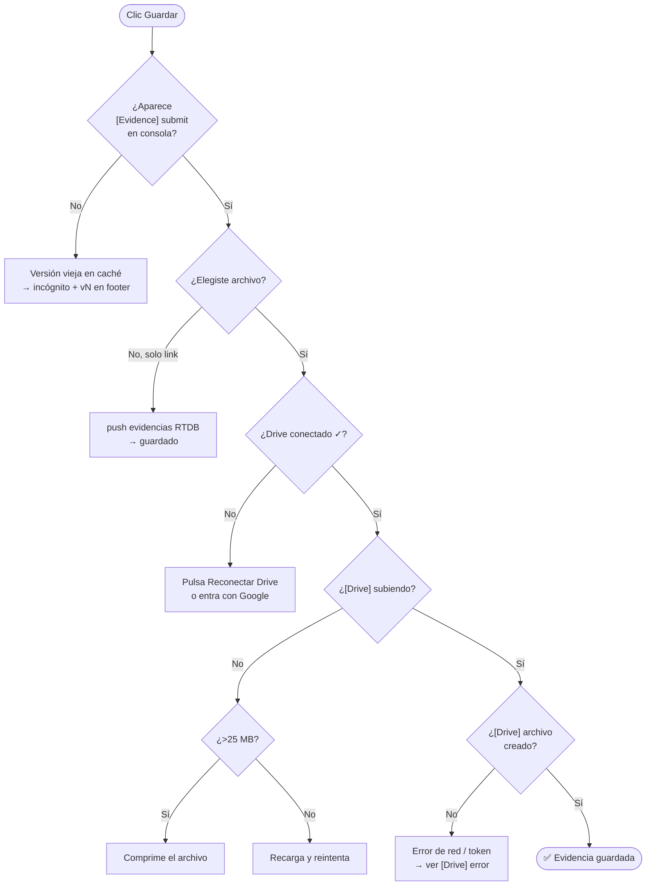
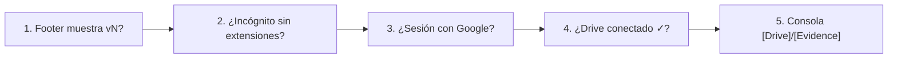

# 🐛 Troubleshooting

[[00 - Inicio (MOC)]] · [[04 - Evidencias y Google Drive]] · [[06 - Deploy (Vercel)]]

#aida #troubleshooting

---

## Árbol de decisión — Subida de evidencia

---

## Errores conocidos

### 🔴 Consola: `EvalError: call to Function() blocked by CSP`
- **Causa:** Chart.js / extensiones (`moz-extension://…`).
- **Solución:** Chart.js eliminado por completo. Los de `moz-extension` son **ruido de extensiones** → probar en incógnito.

### 🔴 `Uncaught ReferenceError: m is not defined` (app.js)
- **Causa:** `renderEvidences` usaba `${m.label}` en vez de `${e.label}`.
- **Solución:** corregido (v6). Un solo carácter rompía toda la galería.

### 🔴 Evidencia aparece un instante y desaparece
- **Causa:** título en `deletedEvidences` → filtro la ocultaba.
- **Solución:** `undeleteTitle()` al guardar (v14).

### 🔴 Al subir, la pestaña se cierra/recarga sola
- **Causa:** conversión a base64 en memoria → pico de RAM.
- **Solución:** subida por streaming `FormData` (v15).

### 🟠 "Entra con Google" aunque la sesión sea de Google
- **Causa:** token en `sessionStorage` (muere entre pestañas).
- **Solución:** `localStorage` + botón **Reconectar Drive** (v13).

### 🟠 Popup Google bloqueado / `missing initial state`
- **Causa:** Firefox + popups bloqueados o storage partitioning.
- **Solución:** usar login por **correo**; popup solo si el navegador lo permite.

### 🟠 ServiceWorker servía versión antigua
- **Causa:** SW cacheaba archivos viejos.
- **Solución:** SW eliminado y **desregistrado** en cada carga + cache-busting `?v=N`.

### 🟡 Warning Firefox: "scroll-linked effect"
- **Causa:** cálculo de scroll en cada evento.
- **Solución:** `requestAnimationFrame` con throttling (v12).

### 🟡 Vercel: `functions.nodeVersion should be object`
- **Causa:** clave inválida en `vercel.json`.
- **Solución:** eliminada la clave `functions`.

### 🟡 GitHub push: `Internal Server Error`
- **Causa:** error temporal del servidor GitHub.
- **Solución:** reintentar `git push origin main`.

---

## Errores que NO son de la página

| Mensaje | Origen |
|---|---|
| `moz-extension://…` / `AI-Sidebar` / `SmartToolbar` | Extensiones del navegador |
| `Summarizer API request … output language` | Extensión IA |
| `AbortError: play() was interrupted` | Extensión intentando reproducir audio |
| `Error de seguridad … file:///` | Extensión intentando abrir archivo local |

> [!tip] Regla de oro
> Si el error menciona `moz-extension://`, `chrome-extension://`, `AI-Sidebar`,
> `SmartToolbar` o `Sider` → **no es nuestro código**. Probar en incógnito sin extensiones.

---

## Diagnóstico rápido (checklist)

- [ ] El **footer** muestra la versión esperada (`v16`).
- [ ] Probado en **incógnito sin extensiones**.
- [ ] Sesión iniciada con **Google** (para subir archivos).
- [ ] Modal dice **"Drive conectado ✓"**.
- [ ] Logs de consola `[Drive]` / `[Evidence]` copiados si falla.
