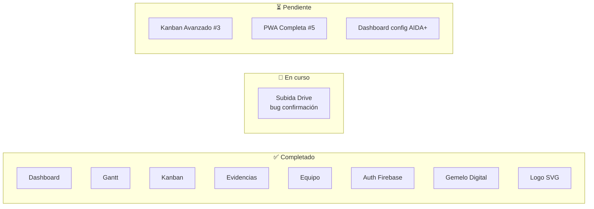
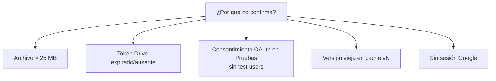
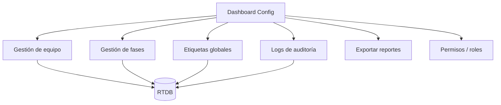

# 🗺️ Backlog y Pendientes

[[00 - Inicio (MOC)]] · [[09 - Troubleshooting]] · [[05 - Kanban y Gantt]]

#aida #backlog

---

## Estado de módulos



---

## 🔶 Bug abierto: confirmación de subida a Drive

**Síntoma:** al dar Guardar, el usuario no ve confirmación ni la evidencia aparece.

**Estado:** v16 desplegada con breadcrumbs (`[Drive]` / `[Evidence]`) + timeout en `undeleteTitle`.

**Hipótesis a confirmar con logs del usuario:**



**Necesario:** que el usuario pegue los logs `[Drive]`/`[Evidence]` de la consola (F12)
o el toast de error. Ver [[09 - Troubleshooting]].

---

## ⏳ #3 — Kanban Avanzado

**Modelo de datos propuesto (RTDB):**

```json
{
  "id": "F1-01",
  "title": "Levantamiento de Requerimientos",
  "assignees": ["uriel", "magaly"],
  "column": "validacion",
  "priority": "alta",
  "tags": ["hardware", "docs"],
  "dueDate": 1735689600000,
  "createdAt": 1735000000000,
  "updatedAt": 1735689600000,
  "order": 0
}
```

**Tareas:**
- [ ] Badge de prioridad con colores (`critica #ff3333`, `alta #ff8800`, `media #ffcc00`, `baja #00cc88`)
- [ ] Indicador "vencida" (🔔 / reloj rojo) + tooltip días
- [ ] Multi-asignación (checkbox de integrantes)
- [ ] Etiquetas personalizadas (input + autocomplete + crear)
- [ ] Selector de fecha límite (`dueDate`)
- [ ] Filtros: prioridad / etiqueta / asignado / vencidas
- [ ] Orden persistente dentro de columna (`order`)
- [ ] Menú `⋮` por tarjeta: Duplicar / Mover a… / Eliminar
- [ ] Atajos: `Enter` abre modal, `Del` elimina

---

## ⏳ #5 — PWA Completa

**Tareas:**
- [ ] `public/sw.js` — cache-first para assets, stale-while-revalidate para `index.html`
- [ ] `public/offline.html` — fallback sin conexión
- [ ] Iconos `192.png` / `512.png` (generados desde `aida-mark.svg`)
- [ ] `beforeinstallprompt` → botón **"Instalar AIDA+"** en el header
- [ ] `theme-color` meta

> [!warning] Cuidado
> El ServiceWorker ya causó problemas (servía archivos viejos). Implementar con
> **versionado de caché** y estrategia de actualización explícita.

---

## ⏳ Dashboard / Tablero de configuración AIDA+

> [!question] Pendiente de definir alcance con el usuario
> El usuario mencionó: *"el dashboard de AIDA+ que se vincula con el equipo y de ahí
> se puede configurar y todo eso"*. Faltan definir:

- [ ] ¿Vista de **administración** (docente/lead) o **vista de cada integrante**?
- [ ] ¿Qué se **configura**? (fases, equipo, colores, logs, exportar, permisos…)
- [ ] ¿Ruta propia (`/config`) o panel/modal lateral?
- [ ] ¿Qué datos muestra/edita? (equipo, fases, etiquetas globales, webhooks, alertas)

**Diagrama tentativo:**



---

## 📋 Otros pendientes (discutidos)

| Idea | Prioridad | Notas |
|---|---|---|
| **FCM Push** | Baja | Descartado temporalmente por el usuario |
| **Telemetría real al Gemelo** | Media | MQTT/WS → `window.AidaTwin.setState()` |
| **Modo Auditoría Docente** | Media | Vista read-only + logs (`by`/`at` ya existen) |
| **Reportes PDF semanales** | Media | Avance, tareas por integrante, evidencias |
| **Gráficas de velocidad** | Baja | Burndown / velocity |
| **Test móvil + touch** | Alta | Drag & drop táctil, viewport del gemelo |
| **Iconos PWA PNG** | Media | Derivados del SVG |

---

## Próximo paso sugerido

1. **Cerrar el bug de subida Drive** (esperar logs del usuario).
2. Luego **#3 Kanban Avanzado**.
3. Después **#5 PWA Completa**.
4. Finalmente **Dashboard de configuración** (tras definir alcance).
